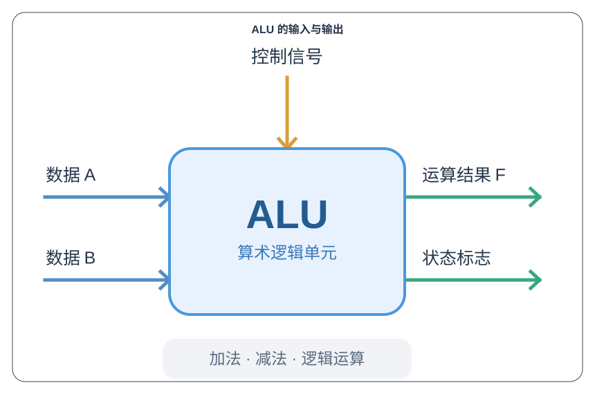
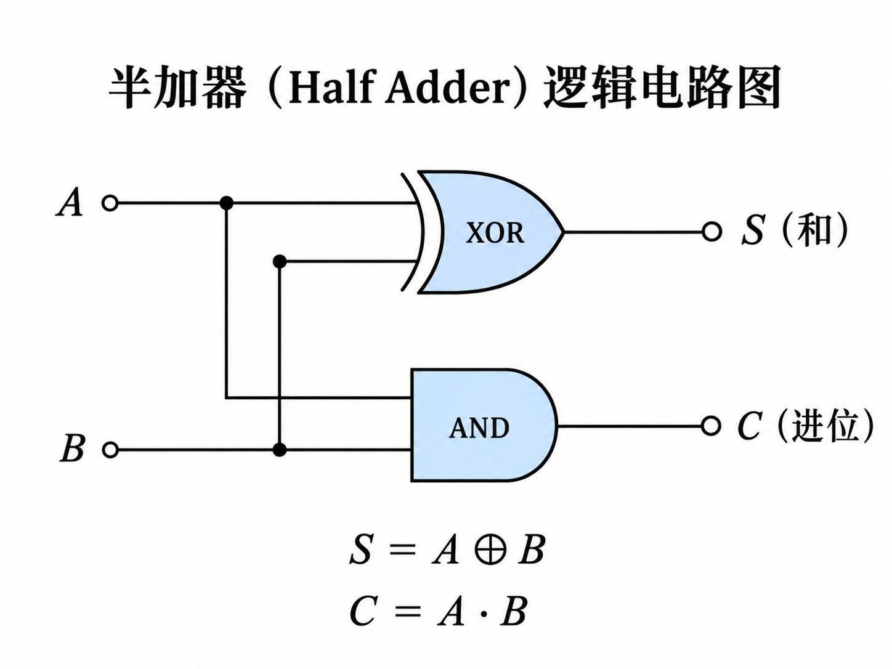
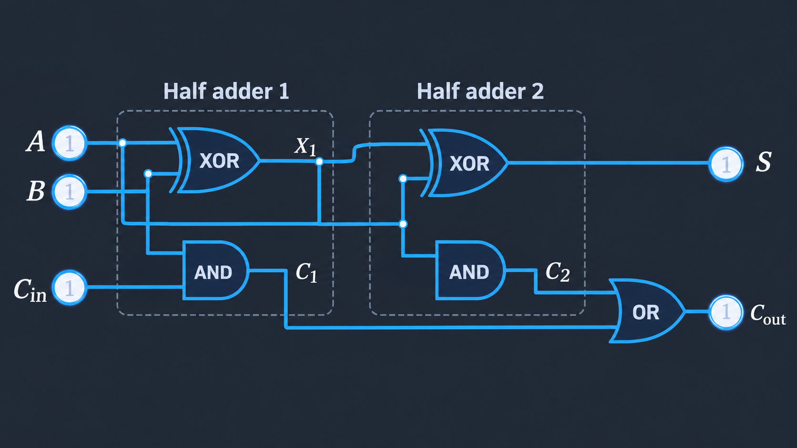
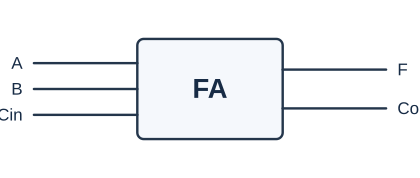
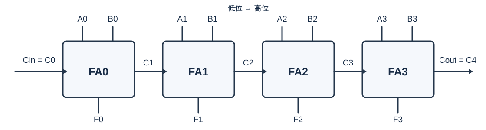
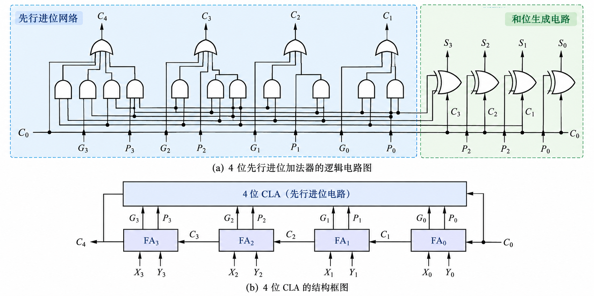
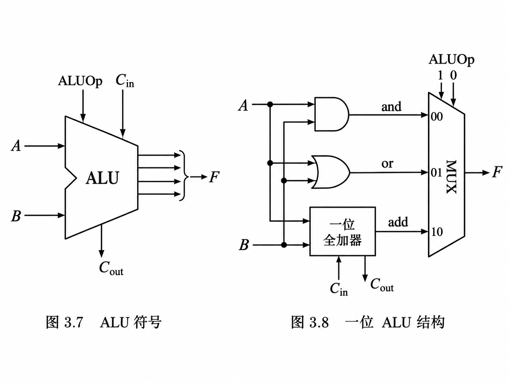
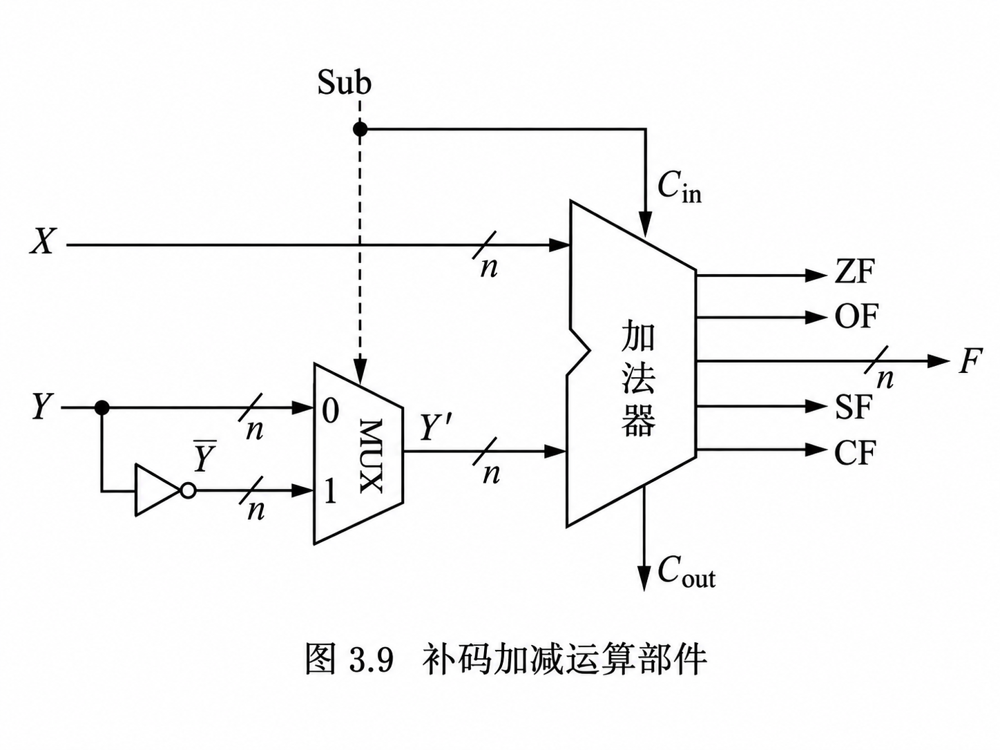
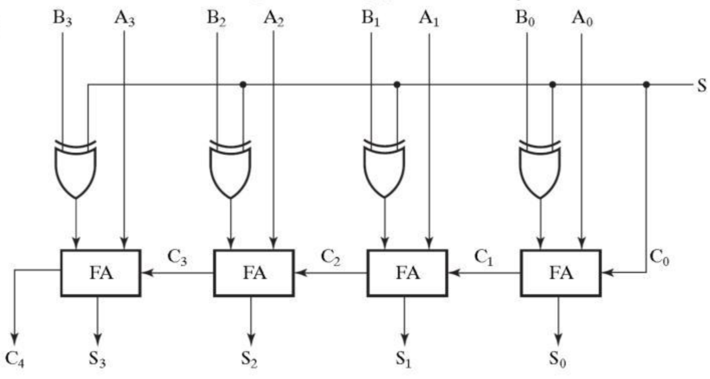
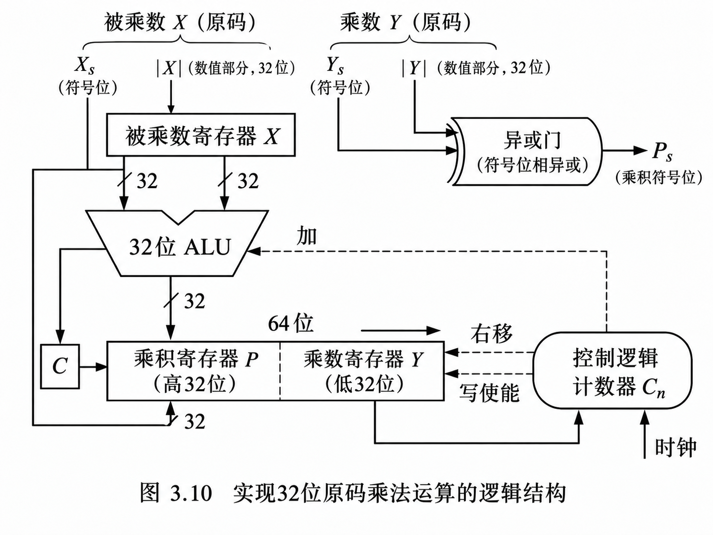

# 运算方法和运算部件
## 基本运算部件
C 语言基本数据类型及其基本运算类型。  
计算机如何实现高级语言程序中的运算：  
- 将各类表达式编译为指令序列
- 计算机直接执行指令来完成运算  

所有运算都可由 ALU 或加法器 + 移位器 + 多路选择器 + 控制逻辑实现。  

### ALU(算术逻辑单元)
ALU 不需要知道数据代表什么含义，只需要根据控制信号，对输入的二进制位执行指定运算。  



### 半加器(Half Adder, HA)
二进制逢二进一，对于单个进制位可以做以下真值表：  

| A | B | 本位结果 S | 进位 C |
|---|---|---|---|
| 0 | 0 | 0 | 0 |
| 0 | 1 | 1 | 0 |
| 1 | 0 | 1 | 0 |
| 1 | 1 | 0 | 1 |

比如 $1 + 1 = 10_2$ 结果 10 中 0 是本位和， 1 是向高一位的进位。  
所以一个二进制加法电路至少需要产生两个输出：  
- **S(Sum)** 本位和  
- **C(Carry)** 向高位的进位

可以发现本位和 S：当 A, B 不同时，S = 1。也就是异或门，所以有：  

$$
S = A \oplus B
$$

进位 C : 当 A、B 都是 1 时，C = 1。也就是与门：  

$$
C = A \cdot B
$$

所以只需要一个异或门和一个与门就能构造半加器。  




### 全加器
计算 $11_2 + 01_2$ 时，需要执行 $1 + 0 + 1 = 10_2$ 这里有三个输入：当前位的 A、B，以及来自低位的进位 $C_m$ 。  
所以全加器壁半加器多了一个输入端：  
| 部件      | 输入      | 输出    |
|-----------|-----------|---------|
| 半加器 HA | A、B      | S、C    |
| 全加器 FA | A、B、Cin | S、Cout |


全加器可以用两个半加器 + 一个或门构成。  

首先第一个半加器计算 A+B 得到中间和与进位：  

$$
P = A \oplus B, \quad C_1 = AB
$$

第二个半加器计算 P + Cin：  

$$
S = P \oplus C_{in}
$$
$$
C_2 = PC_{in}
$$

通过或门合并两个进位：  

$$
C_{out} = C_1 + C_2
$$

所以得到全加器的核心公式：  

$$
S = A \oplus B \oplus C_{in}
$$
$$
C_{out} = AB + (A \oplus B)C_{in}
$$





一个全加器只能计算两个 1 位二进制数，以及来自低位的一个进位。假如要计算 4 位加法，可以把 4 个全加器连接起来，也就是串行进位加法器。所以全加器是多位加法器的基本组成单元。    

### 串行进位加法器(RCA)
进位按串行方式传递，速度慢。  



对于第 i 位全加器：  

$$
S_i = A_i \oplus B_i \oplus C_i
$$

$$
C_{i+1} = A_i B_i + (A_i \oplus B_i) C_i
$$

其中 $C_i$ 是当前位的进位输入， $C_{i+1}$ 是传给下一位的进位输出。  


进位需要逐级传播，产生较长的组合逻辑延迟。比如 32 位串行进位加法器在最不利情况下，进位需要依次经过 32 位全加器。  

> 这类的“串行”指的是进位逐级传播，而不是说它每个时钟周期只计算一位，所有位的输入可以同时提供，整个加法器仍然是一套组合逻辑电路。  
### 并行进位加法器 (CLA)
全加器的进位公式： $C_{i+1} = A_i B_i + (A_i \oplus B_i) C_i$ 可以把公式拆成：  
1. 进位产生信号 $G_i$  

$$
G_i = A_i B_i
$$

当 $A_i = 1, B_i = 1 $ 时，不管低位有没有进位，本位都必然产生进位。也就是 $G$ 表示当前位自己就能产生进位。  

2. 进位传递信号 $P_i$  

$$
P_i = A_i \oplus B_i
$$

当 A, B 一个为 1, 另一个为 0 时， $0 + 1 + C_i$ 如果 $C_i = 0$ 不会产生进位。如果 $C_i = 1$ 就会向高位产生进位。所以 P 表示当前位能够将低位传来的进位继续传递到高位。可将全加器进位公式简化成： $C_{i+1} = G_i + P_i C_i$ 。  

所以并行进位加法器就是通过提前计算进位，提高加法速度。  




#### 四位并行进位加法器
对于 4 位加法，需要计算 $C_1$、$C_2$、$C_3$、$C_4$ 有:  

$$
C_1 = C_0 + P_0 C_0
$$
$$
C_2 = G_1 + P_1 G_0 + P_1 P_0 C_0
$$

$$
C_3 = G_2 + P_2 G_1 + P_2 P_1 G_0 + P_2 P_1 P_0 C_0
$$

$$
C_4 = G_3 + P_3 G_2 + P_3 P_2 G_1 + P_3 P_2 P_1 G_0 + P_3 P_2 P_1 P_0 C_0
$$

最值得观察的是 $C_2$：

$$
C_2 = \underbrace{G_1}_{\text{自身产生}} + \underbrace{P_1 G_0}_{\text{传递前一位产生的进位}} + \underbrace{P_1 P_0 C_0}_{\text{传递初始进位}}
$$

这三个条件只要有一个成立，$C_2$ 就是 1。  
它们可以同时进行逻辑计算，而不必等待电路先得出 $C_1$。

从数字逻辑的角度看，都是相同结构：与门计算乘积项 → 或门合并乘积项 → 得到进位  

### 带标志加法器
带标志加法器 = 加法器 + 状态标志生成电路  

#### 状态标志
| 标志              | 含义                                             |
|-------------------|--------------------------------------------------|
| CF(Carry Flag)    | 进位标志(用于反应最高位是否向字长之外产生了进位) |
| OF(Overflow Flag) | 溢出标志(判断有符号补码运算是否发生溢出)                                         |
| ZF(Zero Flag)     | 零标志(运算结果所有位都为零)                                           |
| SF(Sign Flag)     | 符号标志(反映结果最高位)                                         |


对于一个四位加法器：  

| 标志 | 逻辑电路                              |
|------|---------------------------------------|
| CF   | $CF = C_4$                            |
| OF   | $CF = C_3 \oplus C_4$                 |
| ZF   | $ZF=\overline{S_3 + S_2 + S_1 + S_0}$ |
| SF   | $SF=S_3$                              |


### 算术逻辑部件(ALU)
ALU 可以根据控制信号，选择执行不同的运算。  

  

上图的 ALU 结构可以做与、或和加法运算。通过多路选择器(MUX) 选择输出三种操作结果。上图的控制信号叫做 ALUOp。所以 ALU = 运算电路 + 功能选择电路。  
多位 ALU 可以由多个一位 ALU 组合。 逻辑运算按位独立，加法则需要处理进位。  

#### 减法的实现
对于 n 位二进制数： $A-B=A + \overline{B} + 1(\mod 2^n)$  
引入控制信号 SUB:  
| SUB | 功能 |
|-----|------|
| 0   | 加法 |
| 1   | 减法 |


让 B 的每一位经过一个异或门： $B'_i = B_i \oplus SUB$ ，这样就实现减法的取反。再将 SUB 送到加法器的最低位的进位输入 $C_0$ ：  

$$
F = A + (B \oplus SUB) + SUB\quad (\mod 2^n)
$$

这样 SUB 控制信号就能：控制 B 是否按位取反，控制初始进位 $C_0$ 的值。  


## 定点数运算
| 运算 | 核心思想           | 重点                     |
|------|--------------------|--------------------------|
| 加法 | 补码直接相加       | 进位、溢出判断           |
| 减法 | $A - B = A + (-B)$ | 补码求负、加减法器       |
| 乘法 | 移位加法           | 原码一位乘法、补码乘法   |
| 除法 | 移位减法           | 恢复余数法、不恢复余数法 |

复杂的算术运算可以通过加法、移位和控制逻辑组合实现。  

### 补码加减运算
补码把负数映射成了一个特殊的二进制编码，让普通加法电路也能够处理负数。  

$$
[x+y]_{补} = [x]_{补} + [y]_{补}\quad (mod\ 2^n)
$$

$$
[x-y]_{补} = [x]_{补} + [-y]_{补}\quad (mod\ 2^n)
$$

$$
[-B]_{补} = \overline{[B]_{补}} + 1
$$

补码减法在运算时，实际上仍然是在做二进制加法。  



观察电路有以下关键部分：  
| 部件            | 功能                                     |
|-----------------|------------------------------------------|
| 反向器          | 将 $Y$ 的每一位取反，得到 $\overline{Y}$ |
| MUX(多路选择器) | 选择 $Y$ 还是 $\overline{Y}$             |
| $C_{in}$        | 最低进位输入，实现额外的 $+1$            |
| $n$ 位加法器    | 完成最终的二进制加法                     |

电路实际计算的是： $F = X + Y^{'} + C_{in}\quad(\mod \ 2^n)$

对于多位的补码加减法运算还可以有：  



---
所以有如下认知：  
- 补码解决负数的编码问题
- MUX + 反向器 + 加法器实现统一的加减法运算  
- 状态标志反映结果性质  

### 溢出
溢出指：真实运算结果超出了当前数据类型的表示范围，导致截断后的结果无法正确表示真实数值。  
计算机使用固定位数表示数据，对于 8 位补码表示范围为： $-128 \le x \le 127$  
比如对于 8 位补码计算：$127 + 1 = 128$，但 8 位补码无法表示 128。  

$$
\begin{array}{r}
01111111 \\
+\,00000001 \\
\hline
10000000
\end{array}
$$

10000000 在此实际表示 -128。  

溢出有两种情况：  
- 正溢出：
- 负溢出：  

#### 溢出判断方法
##### 根据操作数和结果的符号判断
对于同号数相加，如果结果与操作数异号，则发生溢出。  

设：  
- $A_s$: 第一个操作数的符号位
- $B_s$: 第二个操作数的符号位
- $F_s$: 运算结果的符号位

有 $OF = \overline{A_s \oplus B_s}\land (A_s \oplus F_s)$  

对于减法 $A-B$ 判断规则是：当 A 与 B 异号，并且结果符号与 $A$ 不同时，发生溢出。  

##### 根据最高进位判断
当进入符号位的进位与从符号位输出的进位不一致时，说明固定位宽的补码加法结果跨越了可表示的范围。  
对于 $n$ 位全加器有：  
- $C_{n-1}$ : 进入符号位的进位
- $C_n$ : 从符号位产生的进位  

有 $OF = C_{n-1} \oplus C_n$  
也就是：  
- 两个进位相同：没有溢出  
- 两个进位不同：发生溢出  

##### 双符号位判断法
把操作数先进行符号扩展，增加一个符号位，再进行运算。  
以刚才的 \(127 + 1\) 为例，使用 9 位补码进行运算：

```text
  0 01111111
+ 0 00000001
------------
  0 10000000
```

结果的最高两位为 `01`，表示正溢出。

判断规则：

| 结果最高两位 | 状态   |
|--------------|--------|
| `00`         | 不溢出 |
| `11`         | 不溢出 |
| `01`         | 正溢出 |
| `10`         | 负溢出 |

这种方法与前面的进位判断法本质上是等价的。

### 原码乘法运算
将乘法转成多次加法与移位。  

对原码有：  
$$
[x]_{\text{原}}=\underbrace{x_s}_{\text{符号位}}\quad\underbrace{x_1x_2\cdots x_n}_{\text{数值位}}
$$

原码乘法的关键在于：**符号位单独处理，数值位按照无符号二进制乘法运算。**  
设乘积为 $p = x \times y$  
有符号位： $p_s = x_s \oplus y_s$    
数值部分：$|p|=|x|\times|y|$  

可以理解为：  
- 两个操作数符号相同，乘积为正  
- 两个操作数符号不同，乘积为负
- 数值位直接相乘，不需要对负数求补码  

#### 原码一位乘法
对于 $5 \times 5 = 25$ 有：  
```
  101
x 101
-----
00101
00000
10100
-----
11001
```

这里主要的操作是：  
- 乘数为 1，保留被乘数
- 乘数为 0，生成全 0 部分积
- 每处理更高的一位，就把对应部分积左移
- 最后把所有部分积相加

由于计算机希望反复利用同一个加法器和一组寄存器完成乘法，而不必一次生成所有部分积。所以原码一位乘法器采用：$判断乘数一位\rightarrow 加法 \rightarrow 右移$  

区别：  
- 竖式乘法：部分积逐行左移
- 硬件算法：被乘数不动，部分积和乘数整体右移。  

**竖式通过左移新部分积来对齐位权，而硬件通过右移已有部分积来实现相同的位权关系。**  


对于硬件：其把数据存放在寄存器中，定义如下寄存器:  

| 寄存器 | 数据                 |
|--------|----------------------|
| X      | 被乘数               |
| P      | 部分积，保存累加结果 |
| Y      | 乘数                 |

这里的 P,Y 不仅用于保存部分积和乘数，还保存最终乘积：P 保存乘积高位，Y 保存乘积低位。  
实际就是：  
- P 负责保存和累加尚未完成的高位部分积。  
- Y 初始保存乘数，随着计算进行，逐渐保存已经形成的乘积低位。  
在每次右移中，P 的最低位需要进入 Y 的最高位。  

所以这是右移乘法器的硬件设计选择。  
因为部分积是累加的结果，引入一个 C:进位位形成：  
C:1|P:3|Y:3 这样的结构，所以 C 是加法器产生的最高进位，是额外的 1 位存储单元。这样右移就是 CPY 这三部分的右移。刚好每次进行 Y 的最低位舍弃也是合理的。  


总的来说：原码一位乘法：  
- 符号位单独处理，乘积符号为两个操作数符号位异或。  
- X 保存被乘数，P 保存部分积，Y 初始保存乘数。
- 根据 Y 的最低位决定是否执行 $P+X$ 。
- 每轮加法后，将 C、P、Y 联合逻辑右移一位。
- 对 n 位乘数执行 n 轮，最终 P、Y 拼接形成 2n 位乘积数值部分。
- 右移的本质是调整每轮加入的部分积的位权，与竖式乘法中左移部分积的效果等价。  

  

#### 原码两位乘法
一位乘法每次处理乘数的一位，现在两位乘法一次处理两位。  
原码两位乘法把乘数按两位划分，这样每次检查的两位共有四种组合：  
| 乘数的两位 | 十进制 | 因加的部分积 |
|------------|--------|--------------|
| 00         | 0      | 0            |
| 01         | 1      | X            |
| 10         | 2      | 2X           |
| 11         | 3      | 3X           |

这里右移两位，是在把处理完的两位乘数移走，同时把部分积的低位送入乘积的低位区域。 所以最终结果仍然保留在组合寄存器中。  

优化 3X： $3X=4X-X$   
有：  

$$
\frac{P_i + 3X}{4}=\frac{P_i - X}{4} + X
$$

也就是遇到 11 时，先减 X，右移两位，将补加的 X 延迟到下一轮。引入 1 位触发器 $T$ ：  
- $T=0$ 下一轮不需要补加 $X$  
- $T=1$ 需要补加 $X$  


### 补码乘法运算
#### Booth 一位乘法
Booth 算法：遇到连续的 1，不必逐位加被乘数，而可以利用其边界，通过加减被乘数完成运算。  
比如 $01110_2 = 10000_2 - 00010_2 = 16 - 2 = 14$  
Booth 一位乘法仍然使用部分积寄存器 P 和乘数寄存器 Y。但是额外增加了辅助位 $Y_{-1}$ 初始为 0。  
每轮同时观察 $Y_0Y_{-1}$，其中 $Y_0$ 是当前乘数的最低位。  
| $Y_0Y_{-1}$ | 对部分积P的操作      |
|-------------|----------------------|
| 00          | 不加不减             |
| 01          | $P\leftarrow P + X$  |
| 10          | $P \leftarrow P - X$ |
| 11          | 不加不减             |


- `01` 对应连续`1`的高端边界，执行 $P \leftarrow P + X$  
- `10` 对应连续`1`的低端边界，执行 $P \leftarrow P-X$  

还是一样的 XPY 寄存器结构，变成 $XPYY_{-1}$ ，且使用算术右移。  

当遇到 `10` 时要执行 $P\leftarrow P - X$ 将其转换为补码减法变成： $P-X=P+[-X]_{补}$   

#### 改进 Booth 两位乘法
它和原码两位乘法一样，目标是把乘法循环次数减少一半。  

### 原码除法运算

对于 $13\div3=4\cdots1$  意味着： $13=\underbrace{3+3+3+3}_{4\text{ 次}}+1$  

所以除法可以理解为：被除数里面包含多少个除数。  

#### 恢复余数法
和竖式除法一样，计算机从被除数最高位开始，逐位确定商。计算机不需要提前知道商是多少，也不需要穷举所有可能的商。它采用类似手算竖式除法的方法：  
1. 从被除数最高位开始，依次取下一位。
2. 判断当前的数能否减去除数。
3. 如果能减，商写 1，保留相减后的余数。
4. 如果不能减，商写 0，保留原来的余数。
5. 将余数左移一位，再带下被除数的下一位，继续试减。

---
恢复余数法从被除数最高位开始，每轮将当前余数左移一位，并带下被除数的下一位，然后减去除数进行试商。
- 试减结果非负：商 1，保留差作为新余数。
- 试减结果为负：商 0，恢复原余数。

对于 $n$ 位无符号被除数，采用上述逐位算法，经过 $n$ 轮产生 $n$ 位商，最后保留的余数就是除法余数。
左移实际就是小学除法中的：「落下一位」  

假设使用两个寄存器：  
- $R$ ：保存当前余数
- $Q$ ：初始保存被除数，之后逐渐保存商  

最开始：  
```
       R        Q
     00000  |  1101
               ↑
              被除数
```

左移后：  
```
R       Q
00001 | 1010
```

这时候 Q 原来的最高位 1 进入 R 的最低位，Q 的最低位暂时补 0，这个位置接下来用来写入本轮商位。  

对比乘法右移：  
- **乘法右移**： 逐步处理乘数，并把部分积的低位送入乘积低位区域。  
- **除法左移**： 逐步把被除数的下一位送入余数寄存器，并把新产生的商位写进商寄存器。  

---
左移之后就是试减、判断、上商。  

$$
R-D\begin{cases}
\geq0&\Rightarrow \text{商 }1\\
<0&\Rightarrow \text{商 }0\text{，恢复余数}
\end{cases}
$$

#### 原码加减交替法(不恢复除数法)
$$
2(R'+D)+b-D=2R'+b+D
$$

左边是恢复除数法，右边是不恢复除数法。  
也就是：  
| 上一轮部分余数 | 本轮先右移，然后 | 本轮操作结果       |
|----------------|------------------|--------------------|
| $R\ge0$        | 减除数 $D$       | 根据新余数正负上商 |
| $R < 0$        | 加除数 $D$       | 根据新余数正负上商 |

每轮运算完成后：  
- 新余数非负：商 1
- 新余数为负，商 0

决定本轮是加还是减，依据的是上一轮留下的余数符号；决定本轮商位，依据的是本轮加减后的余数符号。  
最后一轮结束后，如果余数为负，仍然需要进行一次最终校正。  


### 补码除法运算
补码除法希望直接使用 $[-13]_{补}$ 、 $[3]_{补}$ 参与加减运算，不需要先把负数转换为绝对值。  

这里的加减交替法就有所变化了：  

| -        | -原码加减交替法 | 补码加减交替法       |
|----------|-----------------|----------------------|
| 加减依据 | 旧余数的正负    | 余数与除数是否同号   |
| 上商依据 | 新余数是否非负  | 新余数与除数是否同号 |
| 符号位   | 单独处理        | 参与运算             |

补码除法的核心规则是：  

$$
\boxed{
\begin{cases}
R,D\text{ 同号}&\Rightarrow \text{商 }1\\
R,D\text{ 异号}&\Rightarrow \text{商 }0
\end{cases}}
$$

并且：  

- 余数与除数同号：下一步左移后减除数
- 余数与除数异号：下一步左移后加除数


## 整数乘除法
### 乘除运算溢出
整数乘除法结果可能需要 2n 位。  
比如 4 位×4 位最多需要 8 位结果。如果只用 4 位寄存器保存结果，就会发生乘法溢出。   
对于 n 位无符号乘法，若只保存低 n 位： $R = (X \times Y) \mod\ 2^n$  
而对于有符号整数乘法，可以发现：**相同的 n 位二进制位型，无符号乘法与补码有符号乘法得到的低 n 位乘积相同。**  

所以，**整数乘法的低位性质**:  
对于两个 n 位二进制数：$X_sY_s\equiv X_uY_u\pmod{2^n}$  
- 低 n 位乘积：有符号与无符号结果相同
- 完整 2n 位乘积：高 n 位可能不同
- 无符号溢出：高 n 位不全为 0
- 有符号溢出：高 n 位不是低 n 位的符号扩展  

由此，CPU 对于 n 位乘法中存在两种结果保存方式：  
方式一：只保留低 n 位：  
    32 位整数乘法只保留低 32 位。因为低 n 位相同，所以无符号整数和补码乘法可以用相同的低位计算逻辑。    
方式二：保留完整 2n 位：  
    32 位整数乘法，产生完整的 64 位乘积。这时需要区分有符号和无符号解释，因为乘积高位可能不同。  

### 整数除法
整数除法逆向过来可以有如下公式：  

$$
A = D \times Q + R
$$

- $A$ 被除数
- $D$ 除数
- $Q$ 商
- $R$ 余数

对于非零除数： $|R| < |D|$  

整数除法的特点就是商必须是整数，因此不能整除的部分留在余数中。  
对于负数除法取整比如: $-13 \div 3 = -4.3333...$  
通常是使用**面向零截断**，所以上面的整数除法结果是 -4。  

---
对于余数，由上面的整数除法公式变形为：  

$$
R = A - DQ 
$$


对于采用向零截断的有符号整数除法，有一条重要规律：**余数非零时，它的符号与被除数相同，与除数的符号无关**  

---
有符号与无符号整数除法的结果可能完全不同。  

---
乘法结果超过目标数据类型的表示范围，就可能发生溢出。  

比如 `INT_MIN / -1`，出来的值大于 `INT_MAX` 发生商溢出。这样的整数除法表达式在 C 语言中属于未定义行为，并不是规定会自动截断或者得到某个错误的数。  


CPU 存放整数除法的商和余数：  
由 $A = DQ + R$ 一次整数除法需要产生两个结果：  
- 商 $Q$
- 余数 $R$  
对于 x86 32 位操作数除法：  
- `DIV` 无符号除法
- `IDIV` 有符号除法
- `EDX:EAX` 被除数
- `EAX` 商
- `EDX` 余数

## 浮点数运算
浮点数运算主要包括浮点数的加减乘除运算，一般有高精度浮点数和双精度浮点数运算。有些机器还支持 80 位或 128 位扩展浮点数运算。  
一个二进制浮点数可以表示为：  

$$
X = (-1)^S \times M \times 2^E
$$

其中：  
- $S$ ：符号位
- $M$ ：尾数
- $E$ ：阶码对应的实际指数


### 浮点数加减法
浮点数加减法步骤：对阶->尾数加减->规格化-> 舍入-> 溢出判断。  

#### 对阶&尾数加减
例如对于:  

$X = 1.01_2 \times 2^3$ 和 $Y = 1.10_2\times 2^1$ 其阶码： $E_X = 3$ ，$E_Y = 1$ 指数差： $\Delta E = 3 - 1 = 2$  
所以xvi将 Y 的尾数右移两位，同时将它的阶码增加 2。  

比如现在对阶之后：  $X = 1.0100 \times 2 ^3$ ， $Y = 0.0110 \times 2^3$  

现在两个浮点数的阶码一致就可以直接进行尾数加法：    

```
   1.0100
 + 0.0110
 --------
   1.1010
```

因此：  $X + Y = 1.1010_2 \times 2^3$  而且已经是规格化形式。  

这里一定是**小阶向大阶对齐**，这样通常可以让阶码较小的数通过右移尾数完成对阶，不需要左移较大的尾数。但代价是右移可能丢失尾数的最低位从而损失精度。  


综上：**对阶：小阶向大阶段，尾数右移，阶码增加**   

#### 规格化
对于 IEEE 754 正规数的尾数应该满足： $1 \le M < 2$  也就是尾数必须呈现 `1.xxxx` 的形式。  

但浮点数运算可能产生两种不符合要求的结果：  
- 尾数太大：出现 `10.xxxx` 或 `11.xxxx` 需要右规  
- 尾数太小：出现 `0.0xxxx` 需要左规  

##### 右规：尾数右移，阶码加一
比如计算 $X=1.110_2 \times 2^3$ 和 $Y = 1.010_2 \times 2^3$ ，两个数阶码相同，可以直接相加：  
```
   1.110
 + 1.010
 -------
  11.000
```

这样结果是 $11.000_2 \times 2^3$ 但是 `11.000` 不符合 `1.xxxx` 的规格化要求。需要将尾数右移一位，阶码加一。也就是：  

$$
11.000_2 \times 2^3 = 1.1000_2 \times 2^4
$$

##### 左规：尾数左移，阶码减一
左规一般出现在两个大小接近的浮点数相减时。  
比如 $X = 1.0100_2 \times 2^4$ 和 $Y= 1.0000_2 \times 2^4$ 相减：  

```
   1.0100
 - 1.0000
 --------
   0.0100
```

得到 $0.0100_2 \times 2^4$ ，但希望尾数的最高有效位是 1，因此将尾数向左移动两位。  

```
0.0100 → 0.1000 → 1.0000
          左移1位   左移2位
```


同时阶码减去 2：  
$$
0.0100_2 \times 2^4 = 1.0000_2 \times 2^2
$$

---
综上：  
| 对比     | 左规                  | 右规                             |
|----------|-----------------------|----------------------------------|
| 典型原因 | 尾数相减后出现前导 0  | 尾数相加后产生进位               |
| 尾数操作 | 左移                  | 右移                             |
| 阶码操作 | 减少                  | 增加                             |
| 移位次数 | 可能多次              | 两个已规格化尾数相加通常最多一次 |
| 最终目的 | 使尾数恢复为 `1.xxxx` | 使尾数恢复为 `1.xxxx`            |


#### 舍入
因为尾数只能保持有限位数，但计算结果的小数位更多，就要处理多出来的位。  

假设我们的浮点数只能保存 4 位有效数字，包括小数点前的 1。有计算结果： $X = 1.01011_2 \times 2^3$  但只能保存 4 位有效数字。而舍入就是要在有限精度下，选择符合舍入规则的可表示结果。  

IEEE 754 默认采用就近舍入，遇中间值取偶数。  
- 距离较小的可表示数更近：舍去多余位
- 距离较大的可表示数更近：末位进 1
- 恰好位于两个可表示数中间：选择最低有效位为 0 的那个结果  

假如恰好卡在中间：  
情况 A：某位为 0 ，不进位  
比如：  

$$
1.010\underbrace{1}_{\text{舍弃部分}}\longrightarrow1.010
$$

因为恰好位于 `1.010` 和 `1.011` 中间，而 `1.010` 的末位是 0，所以选择它。  

---

情况 B：末位为 1，需要进位

$$
1.011\underbrace{1}_{\text{舍弃部分}}\longrightarrow1.100
$$

因为恰好位于 1.011 和 1.100 中间，而 1.100 某尾是零，所以选择它。  

##### GRS 位
硬件通过 GRS 位判断进位。计算机不需要把被丢弃的所有位都完整保存下来。 IEEE 754 浮点运算器常使用三个额外的辅助位： G, R, S  

| 辅助位    | 含义                 |
|-----------|----------------------|
| G(Guard)  | 保留精度之后的第一位 |
| R(Round)  | 保留精度之后的第二位 |
| S(Sticky) | 更低所有位的逻辑或   |

比如：  

$$
1.010\ \underbrace{1}_{G}\underbrace{0}_{R}\underbrace{101}_{S\text{ 的来源}}
$$

由于更低三位 101 中至少有一个 1 因此：  $G = 1, \quad R = 0, \quad S=1$  

Sticky 位的关键特性是：只要丢弃区域中曾经出现过 1，S 就保持为 1。  

最近偶数舍入的判断表：  

| G | R | S | 操作 |
|---|---|---|---|
| 0 | 任意 | 任意 | 直接舍去 |
| 1 | 0 | 0 | 恰好一半，按末位奇偶判断 |
| 1 | 0 | 1 | 进 1 |
| 1 | 1 | 任意 | 进 1 |


所以进位条件可以是:  

$$
\text{进位}=G\land(R\lor S\lor L)
$$

其中 $L$ 是保留尾数的最低有效位。  

舍入可能需要再次规格化，阶码可能随之增加。  

##### 其他舍入模式

除了默认的就近舍入， IEEE 754 还规定了其他舍入方向：  

| 模式               | 规则                                      |
|--------------------|-------------------------------------------|
| 就近舍入，偶数优先 | 选择最近值，恰好中间时取最低位为 0 的结果 |
| 向零舍入           | 直接向 0 方向截断                         |
| 向正无穷舍入       | 选择不小于精确值的最小可表示数            |
| 向负无穷舍入       | 选择不大于精确值的最大可表示数            |


#### 溢出判断
浮点数的位数是有限的，因此不仅尾数精度有限，指数 E 的表示范围也是有限的。当规格化、舍入等操作使指数超出支持的范围，就需要进行特殊处理。  

##### 上溢
运算结果的绝对值太大，超出了浮点格式所能表示的最大有限值。  

IEEE 654 中，在默认的就近舍入模式下，整数上溢通常得到 $+\infty$ ，负数上溢通常得到 $-\infty$ 。其他舍入模式可能返回最大有限值，不一定返回无穷大。  
注意：尾数产生进位，不等于浮点数上溢。  

##### 下溢
计算结果太接近 0，超出正常规格化浮点数的精度范围。  

可以用非规格化数来获得更小值。但如果舍入之后连最小非零非规格化数都无法保留，就可能得到带符号的 0。  
所以 IEEE 754 的下溢异常标志通常与结果既微小又不精确有关。  

