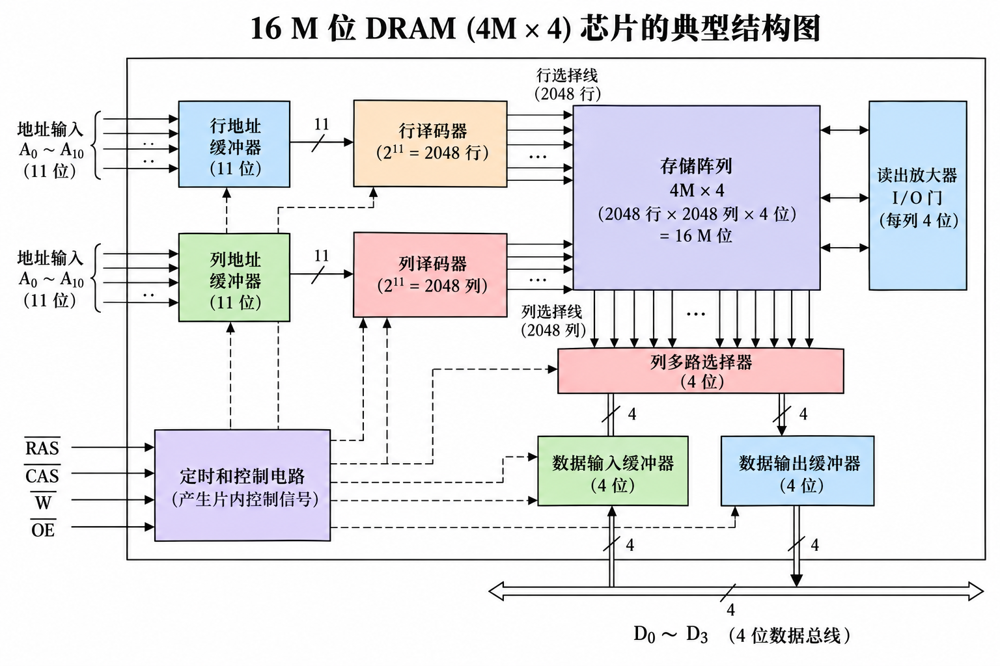
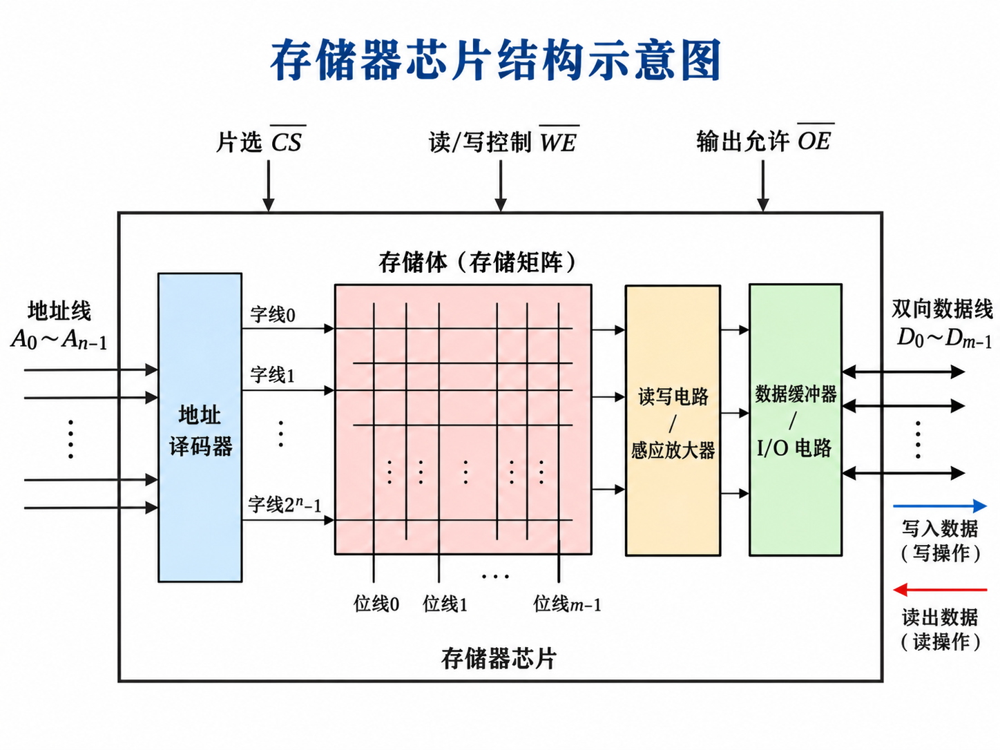
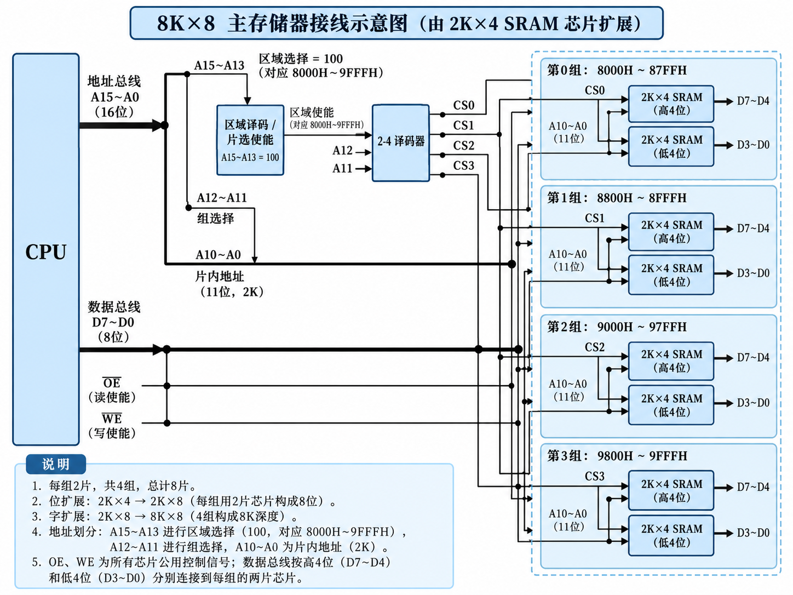
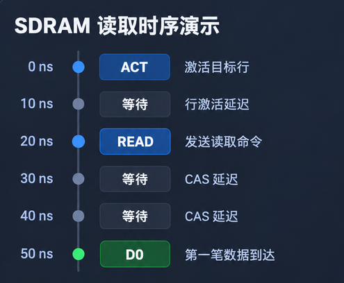
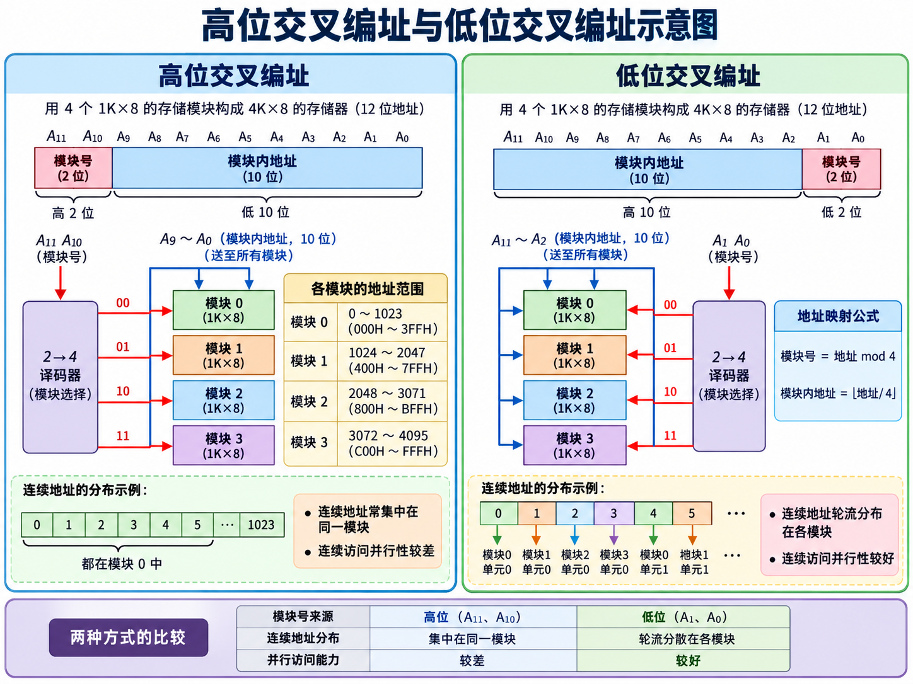
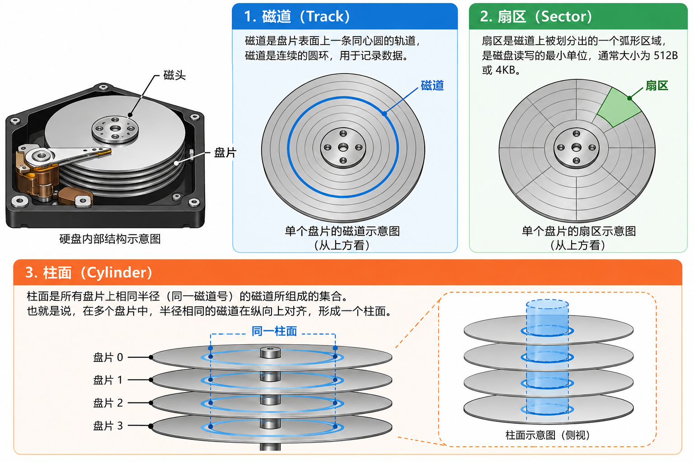
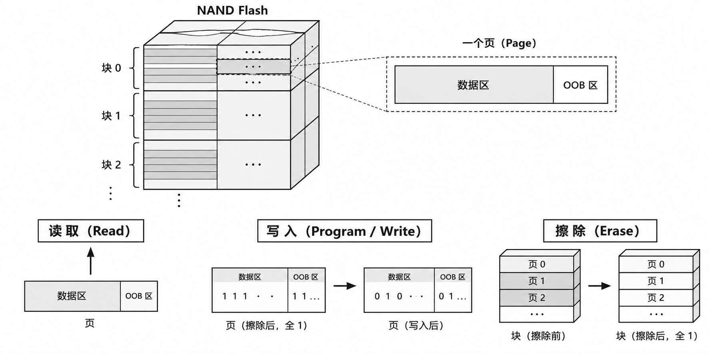
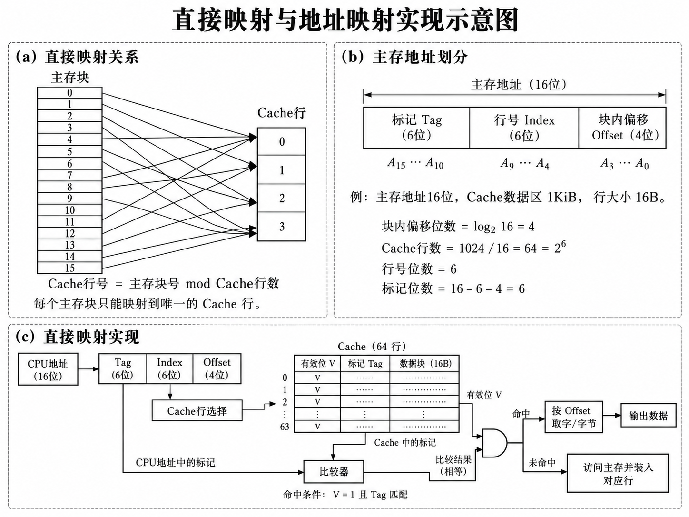
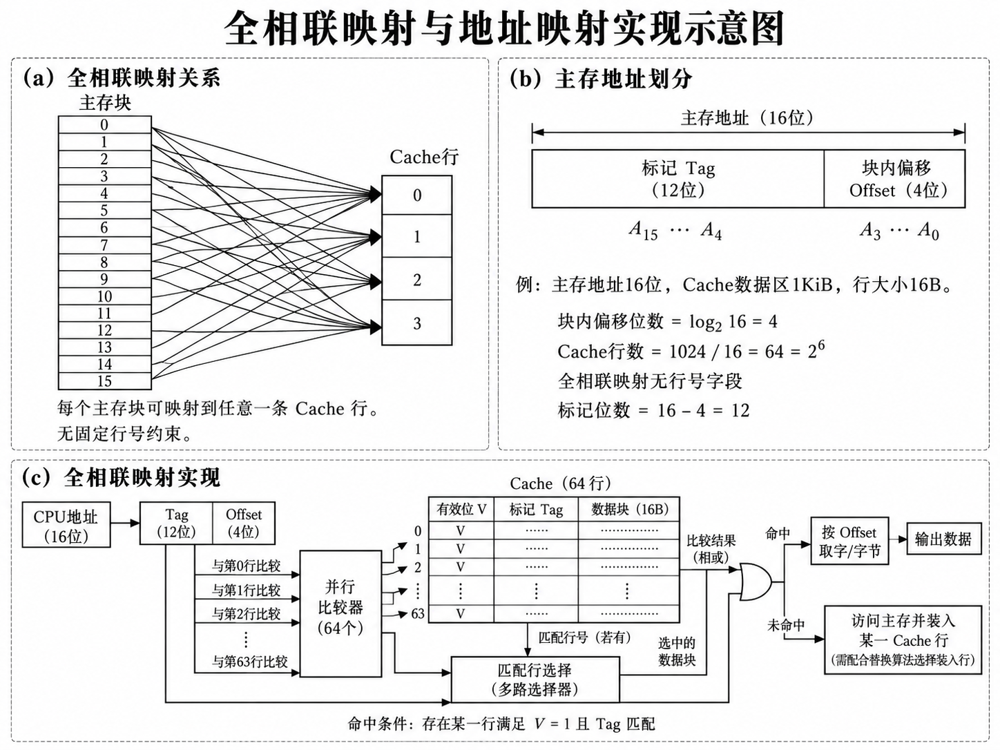
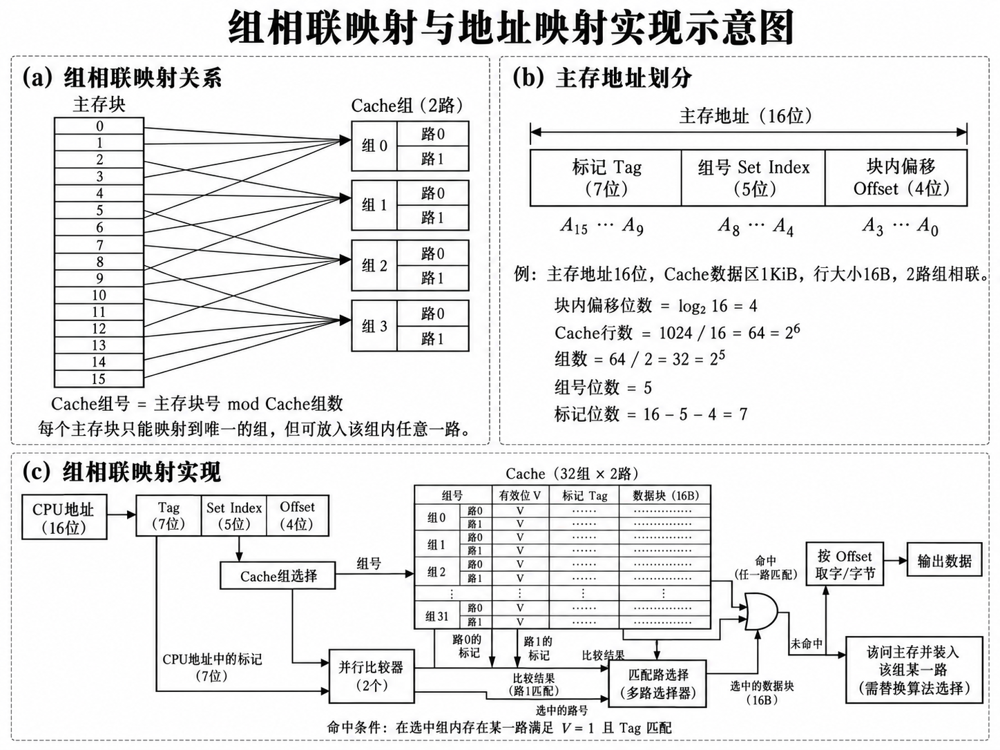

# 存储器层次结构
## 存储器概述
存储器（Memory）是计算机中用于存放程序和数据的部件。    

### 分类
按工作性质/存储方式分类：  
- 随机存取存储器(RAM)
    * 每个单元读写时间一样，且与各单元所在位置无关(如：内存)
- 顺序存取存储器(SAM)
    * 数据按顺序从存储载体的始端读出或写入，因而存储时间的长短与信息所在位置有关(如：磁带)
- 直接存取存储器(DAM)
    * 直接定位到读写数据块，在读写数据块时按顺序进行(如：磁盘)
- 相联存储器(AM)
    * 按内容检索到存储位置进行读写(如：快表)

按存储介质分类：  
- 半导体存储器：双极型、静态 MOS 型、动态 MOS 型  
- 磁表面存储器：磁盘、磁带  

按信息的可更改性分类：  
- 只读存储器ROM
- 可读可写存储器RAM
按断电后信息的可保存性分类：  
- 非易失性存储器：
- 易失性存储器：
### 存储器的层次化结构 

| 类型       | 主要作用                                  | 典型例子         |
|------------|-------------------------------------------|------------------|
| 寄存器     | 暂存 CPU 当前运算需要的操作数、地址和结果 | 通用寄存器       |
| Cache      | 缓存近期或可能再次访问的指令与数据        | L1, L2, L3 Cache |
| 主存       | 保存正在运行的程序和数据                  | DRAM 内存        |
| 辅助存储器 | 长期保存程序、文件和数据                  | SSD、机械硬盘    |

- 主存不等于所有存储器，主存只是整个存储系统一部分。  
- 内存通常指主存。  

#### 为什么不能把存储器做得又快又大
因为速度、容量和成本之间存在权衡。  
一般而言，从寄存器到 Cache、主存，再到辅助存储器：  
- 存储容量通常逐渐增大。
- 单位容量的成本通常逐渐降低。
- 访问速度通常逐渐降低。
如果全部使用速度极快的存储技术，成本会非常高；如果全部使用低成本的大容量存储器，CPU 又会经常等待数据。  

### 主存储器的组成和基本操作
#### 存储元
最基本的存储单位。  
计算机使用二进制表示信息，也就是用 0 和 1 表示数据。  
比如 5 可以写成 $(00000101)_2$  
计算机把它转变成能表示并保持 0 或 1 的存储结构。把这样最基本的存储单位称为存储单元。  
在机基础模型中，一个存储元存储一位二进制信息，即一个 bit。  

#### 存储单元
存储器中能够被独立寻址的基本存储位置，具体能存多少位取决于存储器的组织方式。  
#### 存储字
一个存储单元中存放的二进制代码。  

#### MAR&MDR
CPU 要访问主存至少要解决两个问题：  
1. 访问哪个地址
2. 读取或写入什么数据

在经典主存接口模型中，有两个重要寄存器：  
- MAR：存储器地址寄存器
    保存本次要访问的主存地址。  
- MDR：存储器数据寄存器
    暂存从主存读出的数据，或者准备写入主存的数据。  

可以说：  
- MAR 负责回答“去哪里找”。
- MDR 负责回答“取到什么，或者要存什么”。 

在简化的经典模型中：如果 MAR 有 $n$ 位，就能表示 $2^n$ 个不同的地址；如果 MDR 有 $m$ 位，它一次可以暂存 $m$ 位数据。   

> 实际处理器可能通过 Cache、内存控制器等更复杂的硬件完成访问  

#### 基本操作
主存的基本操作只有两种：读和写。  

##### 读操作
假设地址 001 中存放的是：00000101  
CPU 要读取这个数据，过程可以简化为：    
1. CPU 将地址 001 放入 MAR。
2. CPU 发出读命令，主存根据地址找到对应的存储单元。
3. 主存将该单元中的 00000101 传送到 MDR。
4. CPU 使用读取到的数据继续执行指令。

核心是： $给出地址 \rightarrow 返回数据$  

> 在普通的非破坏性读操作中，主存原来的数据不会因为被读取而改变。  
##### 写操作
现在假设地址 001 原本保存：00000101  
CPU 想把它改成：00001010  
那么过程是：  
1. CPU 将地址 001 放入 MAR。
2. CPU 将待写入的数据 00001010 放入 MDR。
3. CPU 发出写命令，主存把新数据写入地址 001 对应的存储单元。
4. 写入完成后，该单元保存的新内容为 00001010。

写操作的核心： $给出地址 + 给出数据 \rightarrow 保存数据$

> 写入通常会改变目标存储单元原来保存的内容。  

---

$$
\text{总容量}=\text{存储单元数量}\times\text{每单元位数}
$$
$$
\text{地址位数}=n
\quad\Longrightarrow\quad
\text{最多可寻址 }2^n\text{ 个单元}
$$

#### CPU 与主存的连接
CPU 和主存之间主要通过三类总线交换信息：  
- 地址总线（Address Bus）：告诉主存访问哪里。
- 数据总线（Data Bus）：传输实际的数据。
- 控制总线（Control Bus）：指示当前要执行什么操作，以及传递相关状态信号。

**地址总线负责定位，数据总线负责传输，控制总线负责协调。**  

## 半导体随机存储器
### SRAM & DRAM

SRAM: 静态随机存储器
- 典型存储单元使用 6 个晶体管构成锁存电路。
- 只要持续供电，就能保持数据，通常不需要周期性刷新。
- 速度快、成本较高、集成密度相对较低。
- 典型用途：CPU Cache。

DRAM：动态随机存储器
- 典型存储单元由 1 个晶体管和 1 个电容构成。
- 利用电容存储的电荷表示数据，但电荷会逐渐泄漏。
- 需要周期性刷新，速度特性与成本、密度均不同于 SRAM。
- 典型用途：计算机主存。

SRAM 用电路维持状态：这是能够保持两种状态的电子电路。状态为 0 或 1。    
DRAM 用电容保存电荷  
> DRAM 可以想象成一个微型储水容器，有电荷表示一种状态，没有或电荷较少表示另一种状态。但电荷会泄漏，因此必须定期刷新，重新维持存储数据。  

由此得到最重要的对比：

| 对比项目     | SRAM             | DRAM         |
| ---          | ---              | ---          |
| 基本存储原理 | 锁存电路         | 电容存储电荷 |
| 是否需要刷新 | 不需要周期性刷新 | 需要         |
| 典型速度     | 更快             | 相对较慢     |
| 集成密度     | 相对较低         | 较高         |
| 单位容量成本 | 较高             | 较低         |
| 典型应用     | Cache            | 主存         |

这两者都是易失性存储器，断电后通常会丢失数据，SRAM 的静态并不意味着断电后仍能保存数据。  




### 存储芯片
一块存储芯片主要由三个重要组成部分：  



| 部件       | 作用                       |
|------------|----------------------------|
| 存储矩阵   | 真正保存二进制数据         |
| 地址译码器 | 根据地址找到对应存储单元   |
| 读写电路   | 负责把数据读出来或者写进去 |
| 地址线     | 确定访问哪个存储单元       |
| 数据线     | 负责数据传输               |

---
假设一块芯片的规格是：$1K \times 8 位$，因为 $1K = 1024 = 2^{10}$  
所以：  
- 存储单元数量：1024
- 每个存储单元的宽度： 8 bit  
- 地址线：10 根
- 数据线：8 根(假设采用 8 位并行数据接口)

#### 存储矩阵
一个地址对应一个存储单元，一个存储单元可以保存多个 bit。  

#### 地址译码器
CPU 传过来一个二进制地址，地址编码器将其转移成对应的存储单元选择信号。   

#### 读写控制信号 CS、OE、WE
常见 SRAM 芯片有三个控制信号：  
| 信号            | 英文          | 作用     |
|-----------------|---------------|----------|
| $\overline{CS}$ | Chip Select   | 片选     |
| $\overline{OE}$ | Output Enable | 输出使能 |
| $\overline{WE}$ | Write Enable  | 写使能   |

> 这些信号都是以低电平有效的 SRAM 为例
---

CS 是一个控制信号，决定某块存储芯片是否参与当前访问。很多芯片使用低电平有效的片选信号，写作 $\overline{CS}$  

| $\overline{CS}$ | 芯片状态                 |
|-----------------|--------------------------|
| 0               | 被选中，可以执行相应操作 |
| 1               | 未被选中，不参与当前读写 |

使指定的存储芯片参与当前访问。  
两个层次：  
- 片选：选择哪一块芯片
- 地址译码：在被选中的芯片内部选择哪个存储单元

---
例题：  
- CPU 使用 12 位地址访问这片存储空间
- 每块 SRAM 容量为 $1K \times 8 位$
- 一共有 4 块 SRAM
- 需要组成 $4K \times 8 位$ 的存储器

答：一块芯片有： $1K=2^{10}$ 个存储单元，所以每块芯片内部需要 10 位地址，四块芯片构成 $4K = 2^{12}$ 个存储单元。所以存储器需要 12 位地址。  


假设还是这 12 位地址，一般把其分为高 2 位做片选地址，低 10 位做片内地址，这样的连续编址典型方案。  
这样 $2^2 = 4$ 高 2 位恰好能够区分 4 块芯片，而 $2^{10} = 1024$  低 10 位恰好能够区分每块芯片内部的 1024 个存储单元。  

| A11、A10 | 被选中的芯片 | 十六进制地址范围 |
|----------|--------------|------------------|
| 00       | 芯片0        | `000H~3FFH`      |
| 01       | 芯片1        | `400H~7FFH`      |
| 10       | 芯片2        | `800H~BFFH`      |
| 11       | 芯片3        | `C00H~FFFH`      |


这也可以引出 **字扩展** 的概念：存储单元数量增多了，但每个存储单元的数据位数没有变化。  

### 存储芯片的拓展
- **字扩展**：增加可寻址存储单元的数量
- **位扩展**：增加每个存储单元的数据位数

两种扩展还可以同时进行，这叫字位同时扩展。  

| 比较     | 字扩展                 | 位扩展           |
|----------|------------------------|------------------|
| 增加什么 | 存储单位数量           | 每单元位数       |
| 地址线   | 需要增加地址选择位     | 通常不增加       |
| CS 片选  | 不同芯片按地址分别选中 | 同组芯片共同选中 |
| 数据线   | 同一组数据线共享       | 连接不同的数据位 |
| 例子     | 1K×8 → 4K×8            | 1K×8 → 1K×16     |

总结:  

$$
位扩展倍数 = \frac{目标字长}{芯片字长}
$$

$$
字扩展倍数 = \frac{目标存储字数}{芯片存储字数}
$$

$$
芯片总数 = 位扩展倍数 \times 字扩展倍数
$$


#### 存储器扩展综合题
##### 1
已知某计算机具有：  
- CPU 地址总线宽度为 16 位，按字节编址。
- CPU 数据总线宽度为 8 位。
- 现有若干块 2K × 4 位 的 SRAM 芯片。
要求使用这些芯片构成一个 8K × 8 位 的存储器，地址范围为：$8000H - 9FFFH$  

请确定芯片数量、地址线连接、数据线连接和片选方案。  

解：  
1.确定芯片个数：  
原 SRAM 芯片：2K × 4：2K 个单元，每单元 4 位，而目标存储器需要 8K × 8：8K 个单元，每单元 8 位。  
线进行位扩展：  

$$
\frac{8}{4} = 2 块/组
$$

$$
\frac{8K}{2K} = 4 组
$$

所以需要： $2 \times 4 = 8 块 SRAM 芯片$  

每组两块芯片共同保存一个 8 位数据，四组分别负责不同的地址范围。  

第二步：分配 CPU 的 16 位地址位  
每块芯片有 $2K=2^{11}$ 个单元，因此需要 11 跟片内地址线。  
目标存储器是 $8K = 2^{13}$ 个单元，需要 13 位地址来区分内部所有位置。  

所以：  
高 3 位判断当前地址是否属于本存储器；中间 2 位选中四组中的一组；低 11 位确定组内的存储单元。  

```
A15~A13：判断当前地址是否属于本存储器
A12~A11：选中四组中的一组
A10~A0 ：确定组内的存储单元  
```

但是高三位是 100，因为：  
$$
8000H = 1000 0000 0000 0000_2
$$
$$
9FFFH = 1001 1111 1111 1111_2
$$

在整个地址范围中，A15 ~ A13 都固定为 100，所以判断高三位是否为 100，就能判断 CPU 是否正在访问这片内存。  

第三步：地址译码与片选  
4 组存储芯片的地址分配：  


| 组号 | A12, A11 | CPU 地址范围  |
|------|----------|---------------|
| 0    | 00       | `8000H~87FFH` |
| 1    | 01       | `8800H~8FFFH` |
| 2    | 10       | `9000H~97FFH` |
| 3    | 11       | `9800H~9FFFH` |




### DRAM 的刷新机制
DRAM 存储元由一个晶体管和一个电容组成，电容利用电荷保存二进制信息，电荷会逐渐泄漏，因此需要定期刷新。其内部的存储元按照行、列组成存储矩阵。  

DRAM 的刷新通常**按行**进行：  
1. 选中需要刷新的行
2. 通过感测放大和恢复电路，恢复该行存储元中的数据
3. 再刷新下一行

所以:**刷新次数通常由存储矩阵的行数决定，而不是存储元总数。**  

比如：一个 DRAM 存储矩阵有 1024 行，256 列。尽管包含 $1024 \times 256 = 262144$ 个存储单元，但完成一轮全矩阵刷新通常只需要 1024 次行刷新操作。  

#### 刷新周期
假设所有存储行必须在 64 ms 内至少刷新一次，这里的 64 ms 就是刷新周期。  
注意，不是每隔 64 ms 只刷新一行，而是每个存储行都必须在规定时间内得到刷新。  

现在假设：  
- DRAM 有 1024 行
- 刷新周期为 64 ms

如果均匀安排刷新，平均每隔 $t = \frac{64 ms}{1024} = 62.5 \mu s$ 刷新一行。  

> 这里是按均匀安排的方案。  

#### 三种 DRAM 刷新方式
##### 集中刷新
**先正常访存，再集中刷新全部存储行。**  
优点：集中安排刷新，控制逻辑相对简单  
缺点：刷新期间不能正常访问存储矩阵，出现一段连续的不可访存时间。这段时间通常称为**刷新死时间**。  

比如：有 128 行，每行刷新耗时 $0.5 \mu s$ 那么连续刷新完所需时间为： $128 \times 0.5 = 64 \mu s$  
这 64 μs 就是该简化模型中的集中刷新死时间。  

##### 分散刷新
**把刷新操作安排到每个存储器工作周期中。**  
在经典模型中，可以把一个工作周期分成：  
- 前半部分用于正常读写
- 后半部分用于刷新一行

这样每个工作周期都安排一次刷新，不需要等待集中刷新阶段。  

优点：避免了一大段连续的集中刷新死时间。  
缺点：每个工作周期都包含刷新时间，导致存储器有效访存速度降低。  

##### 异步刷新
**把所有行的刷新操作均匀分布在规定刷新周期内。**  

异步刷新公式： $t_{间隔}=\frac{T_{刷新周期}}{N_{行}}$  
比如： $T = 64ms,\quad N = 1024$ 则： $t_{间隔} = \frac{64 ms}{1024}= 62.5 \mu s$ 
##### 总结
| 比较           | 集中刷新       | 分散刷新             | 异步刷新         |
|----------------|----------------|----------------------|------------------|
| 刷新安排       | 集中刷新所有行 | 每个工作周期刷新一行 | 均匀安排各行刷新 |
| 连续刷新死时间 | 较长           | 无集中的长死时间     | 通常较短         |
| 正常访问影响   | 阶段性暂停     | 每个周期有刷新开销   | 间歇性暂停       |
| 重点           | 死时间计算     | 访存周期变化         | 刷新间隔计算     |


---
不同材料不同生产工艺的动态存储器的刷新周期不同，刷新时间间隔不能超过刷新周期。  
以单体的容量为计算依据，同时考虑双译码的原则。  

### DRAM 行列地址复用
如果有一块 DRAM 芯片: $1M \times 1 位$ 意味着有 $1M = 2^{20}$ 个存储单元，每个存储单元保存 1 bits。  

$2^{20}$ 意味着 20 位地址。  
如果采用普通的、地址不复用的设计，需要 20 根地址输入线。但 DRAM 希望降低芯片的引脚数量，将存储单元排列成矩阵：  
把 $2^{20}$ 个存储元组织成: $1024 \times 1024$ 的矩阵，也就是：  
- 1024 行
- 1024 列
- 每个位置存储 1 bit

现在访问一个存储单元需要确认选择哪一行，哪一列。而这样就可以**分两次传输地址**。  

比如这个例子，第一次传输行地址 10 位，第二次传输列地址 10 位。这样同一组 10 根地址引脚：先接收行地址，再接收列地址。   
于是这样：完整地址仍然是 20 位，但实际只需要 10 根地址输入引脚，将行地址与列地址分时传输。  

经典异步 DRAM 使用两个重要控制信号：  
| 信号 | 英文                  | 用途       |
|------|-----------------------|------------|
| RAS  | Row Address Strobe    | 行地址选通 |
| CAS  | Column Address Strobe | 列地址选通 |


经典异步 DRAM：   
1. 控制器将行地址送到地址引脚
2. 通过 RAS 信号锁存行地址，选中对应的行
3. 控制器将列地址送到同一组地址引脚
4. 通过CAS 信号锁存列地址，选中对应。的列
5. 完成数据读取或写入

所以： $行地址+列地址\rightarrow 确定存储位置$    

> RAS 和 CAS 是对应的选通信号，不是额外的地址位。现代 SDRAM 和 DDR 内存采用同步命令与更复杂的时序，不完全等同于这种经典异步 DRAM 的控制方式。  

### SDRAM 技术
Synchronous Dynamic Random-Access Memory，同步动态随机存取存储器。  

SDRAM 本质上仍然属于 DRAM。与传统异步 DRAM 相比，最大的变化是：SDRAM 的命令和操作时序受时钟协调。  

相比于异步 DRAM，SDRAM 引入了时钟 CLK。   

| 比较     | 异步 DRAM                  | SDRAM                |
|----------|----------------------------|----------------------|
| 外部时钟 | 命令不依赖统一时钟         | 使用统一时钟协调命令 |
| 命令时序 | 根据控制信号的时序要求工作 | 按时钟边沿接收命令   |
| 数据传输 | 受异步访问时序约束         | 支持同步、突发式传输 |
| 刷新     | 需要                       | 仍然需要                 |


**SDRAM 的同步指操作时序与时钟协调，不代表发出读取命令后立即得到数据。**   

#### 时钟周期
如果 SDRAM 的时钟频率为 $f = 100MHz$ 那么时钟周期为： $T = \frac{1}{f}=\frac{1}{100 \times 10^6} = 10 ns$  
也就是说：每经过 10 ns，时钟完成一个周期。  

SDRAM 访问延迟在简化的访问情形中，假设目标行尚未激活，那么读取过程为：  
1.**ACT(Activate): 激活目标行**
让目标行的数据进入可访问状态。  
2.**等待行到列的延迟**
必须等待行激活操作满足规定的时序要求。  
3.**READ: 发出列读取命令**
指定要读取的列地址。 
4.**等待 CAS 延迟**
经过规定的时钟周期后，第一笔读取数据出现在数据总线上。  

这里有两个重要的时间参数：  

| 参数            | 含义                                                                      |
|-----------------|---------------------------------------------------------------------------|
| $t_{RCD}$       | 从行激活命令道允许发出列读写命令的最小延迟                                |
| CL(CAS Latency) | 从 READ 命令道第一笔数据输出的时钟周期数，在基础 SDR SDRAM 模型中这样计算 |


##### 一次 SDRAM 需要多久
假设：  
- 时钟频率为 100 MHz  
- $t_{RCD} = 2$ 个时钟周期
- $CL = 3$ 个时钟周期
- 目标行尚未激活，且忽略其他时序开销  

首先 $T = 10 ns$  在第 0 个时钟边沿发送 ACT，经过两个周期，在第 2 个时钟边沿发送 READ,再经过三个周期，再第 5 个时钟边沿得到第一笔数据。     



所以从 ACT 到第一笔数据的延迟为 50 ns：$(2+3) \times 10 = 50 ns$  

这是一个简化模型，假设没有预充电额外等待。  
实际 SDRAM 的访问延迟还取决于目标行是否已经打开，是否需要关闭其他行、总线状态以及其他时序约束。比如：目标行已经激活（行命中），就可能不需要重新执行 ACT，从而节省行激活相关的等待时间。  

### 内存条和内存条插槽
内存条（DIMM）是将多个 DRAM 芯片安装在电路板上形成的存储模块，通过内存插槽连接到计算机的内存通道。  
假设某种 DRAM 内存条的数据宽口宽度为 8 位，而我们希望构建一个 64 位宽的数据接口。就可以用 $\frac{64}{8} = 8$ 块芯片，让 8 块芯片并行提供数据，每块负责其中 8 bits。  
### 存储器芯片的扩展
把主存分成若干个可以独立工作的模块，各模块能够在一定条件下并行或交错完成存储操作。  

两种组织方式：  
- 高位交叉编址
- 低位交叉编址

#### 高位交叉编址
假设有 4 个存储模块，每个模块容量为： $1K \times 8 位$ 总容量 $4K \times 8 位$ ，需要 12 位地址，因为 $4K = 2^{12}$   
比如可以高 2 位确定模块号，低 10 位：模块内地址。  
| 模块 | 地址范围 |
| --- | --- |
| 模块 0 | 0～1023 |
| 模块 1 | 1024～2047 |
| 模块 2 | 2048～3071 |
| 模块 3 | 3072～4095 |

连续的地址通常集中在同一个模块中，如果同一个模块尚未完成上一次访问，就无法立即启动下一次访。所以高位交叉编址虽然能扩大容量，但不利于提高连续访问的并行程度。  

#### 低位交叉编址
如果仍然是 4 个存储模块每个模块 $1K \times 8 位$  
但使用地址的低 2  位选择模块，高 10 位作为模块内部地址。  

这样低位交叉编址的模块号计算公式是： $模块号 = 地址 \mod m$ 其中 $m$ 是编码数量。  

而模块内地址位：$\text{模块内地址}=\left\lfloor\frac{\text{地址}}m\right\rfloor$  
这样的分布使连续地址分散在不同模块中，为交错访问创造条件。  

---

| 比较 | 高位交叉 | 低位交叉 |
| --- | --- | --- |
| 模块号 | 高位地址 | 低位地址 |
| 连续地址分布 | 多数集中在同一模块 | 轮流分布在各模块 |
| 连续访问并行性 | 较差 | 较好 |
| 典型考点 | 地址范围计算 | 模块号、流水访存计算 |

> 注：低位交叉本身不保证性能一定更高，还需要控制器支持交错访问，模块和总线的时序也要满足条件。



#### 计算
假设：  
- $m$ 存储模块数量
- $T$ 每个模块的存取周期
- $\tau$ 连续两次访问的启动间隔
- $n$ 连续访问的存储字数量

为了连续交错访问时不重复占用尚未准备好的模块，需要：  
$$
m\geq\left\lceil\frac{T}{\tau}\right\rceil$$  


在理想流水式访存模型中，假设首次访问延迟等于 $T$ ，之后每隔 $\tau$ 得到一个字：

$$
t=T+(n-1)\tau
$$

## 外部辅助存储器
把系统运行时直接和主存交换信息的存储器成为辅助存储器，简称辅存。  
因为它不能和 CPU 直接进行信息交换，所以相对于直接和 CPU 进行信息交换的内部主存储器来说，它属于外部存储器，在电源掉电时，可以保证信息不丢失，因而所有外部辅助存储器都是非易失性的。  

### 磁盘存储器的结构
机械硬盘主要包含：  
| 部件   | 功能                        |
|--------|-----------------------------|
| -盘片  | 表面覆盖磁性材料，保存数据- |
| 主轴   | 带动盘片高速旋转            |
| 磁头   | 负责读取和写入数据          |
| 磁头臂 | 带动磁头沿盘片径向移动      |

硬盘磁头正常工作时并不接触盘片表面。磁盘读写时，存在两种不同的机械运动：  
- 盘片旋转：使目标数据经过磁头下方。
- 磁头移动：让磁头到达目标磁道所在的半径位置。

磁道，扇区，柱面：  


在传统共用磁头臂组件的硬盘模型中，磁头定位到某个半径后，可以通过切换磁头访问该柱面上不同盘面的磁道，而无需再次进行径向寻道。  

因此：
- 磁道：一个盘面上的同心圆轨道。
- 柱面：不同盘面上半径相同的一组磁道。

#### 磁盘找到指定数据
在传统 CHS(Cylinder-Head-Sector) 寻址模型中，使用三个量描述数据的位置：  
| 参数      | 含义                 |
|-----------|----------------------|
| C(柱面号) | 确定磁头所在半径     |
| H(磁头号) | 确定使用哪个记录表面 |
| S(扇区号) | 确定使用哪个记录表面 |


$$
(C, H, S) = (5, 2, 10)
$$

可以理解为：定位到第 5 号柱面，选择第 2 号磁头，访问对应磁道上的第 10 号扇区。  

现代硬盘通常通过 LBA (逻辑块寻址) 向操作系统提供扇区地址，实际物理位置由硬盘控制器管理。  

CPU 要从机械硬盘读取一个扇区。需要经历：  
1. **寻道**(Seek)：磁头臂移动，让磁头到达目标磁道所在的半径。
2. **旋转等待**（Rotational Latency）：等待盘片旋转，让目标扇区转到磁头下方。  
3. **数据传输**（Transfer）：磁头读取经过的数据，并由硬盘系统完成数据传输。  

$$
T_{访问} = T_{寻道} + T_{旋转} + T_{传输}
$$

### 磁盘存储器的性能指标

#### 1. 磁盘访问时间

$$T=T_s+T_r+T_t$$

- 寻道时间 $T_s$：磁头移动到目标磁道的时间，通常由题目给出。
- 平均旋转延迟：$T_r=60/(2n)$ s，$n$ 为转速（r/min）。
- 传输时间：$T_t=(读取扇区数/每磁道扇区数)\times60/n$ s。

#### 2. 数据传输率

$$R=\frac{b\times n}{60}$$

$b$：每磁道数据量（B），$n$：转速（r/min）。

#### 3. 磁盘容量

$$C=H\times N\times S\times B$$

- $H$：记录盘面数
- $N$：每盘面磁道数
- $S$：每磁道扇区数
- $B$：每扇区字节数

#### 4. 例题

转速 7200 r/min，平均寻道时间 5 ms，每磁道 100 扇区。

读取 1 扇区：

$$T_s=5\text{ ms}$$
$$T_r=4.167\text{ ms}$$
$$T_t=0.0833\text{ ms}$$
$$T=9.25\text{ ms}$$

#### 易错点

1. 平均旋转延迟通常是半圈时间，而不是一圈。
2. 寻道时间、旋转延迟、传输时间不能混淆。
3. 连续读取多个相邻扇区，通常不用为每个扇区重新计算寻道和平均旋转延迟。
4. 注意 r/min、ms、s 以及 MB/MiB 的换算。
5. 公式适用条件以题目所给的磁盘组织和访问模型为准。

### 磁盘连接
磁盘控制器负责把上层的读写请求转换成具体的设备操作，例如定位目标数据、控制读写、执行错误检测等。  
外存通过相应的 I/O 接口及控制器与计算机交换数据。  

#### RAID: 冗余磁盘阵列
把多个磁盘组织起来，作为一个逻辑存储系统使用，以改善性能、容量利用或故障容忍能力。  
有三种典型级别：  
##### RAID 0：条带化
把数据分散到不同磁盘，可以并行访问，但没有数据冗余。任意一块磁盘损坏，都可能导致了整个阵列的数据不可用。  
##### RAID 1：镜像
两块磁盘保存相同的数据，一块损坏后，另一块仍可提供数据。代价是需要额外的存储容量。  
##### RAID 5：分布式奇偶校验
数据与校验信息分散存储。典型 RAID 5 可以容忍任意一块成员磁盘故障，通过剩余数据和校验信息重建丢失内容。   

---
对于等容量磁盘，常见 RAID 的容量规律是：  

| 类型        | 可用容量         | 容错能力       |
|-------------|------------------|----------------|
| RAID 0      | $N \times C$     | 无冗余         |
| 两盘 RAID 1 | $C$              | 可容忍一盘故障 |
| RAID 5      | $(N-1) \times C$ | 可容忍一盘故障 |

其中 $N$ 是磁盘数量， $C$ 是每块磁盘容量，且假设磁盘等容量。  

RAID 5 至少需要 3 块磁盘。要注意，RAID 提供的冗余不等于数据备份，它不能替代对误删除，文件损坏等情况的保护。  

#### Flash 存储器
- DRAM 使用电容保存电荷，需要周期性刷新，断电后无法保持数据。
- Flash 使用具有电荷存储能力的半导体存储单元，能够在断电后保存数据。  

所以 Flash 属于**非易失性半导体存储器**。  

Flash 主要由 NOR FLash 和 NAND Flash (广泛用于 SSD 和 U 盘)两种类型。  

##### NAND Flash
NAND Flash 通常以页为单位读取和编程(写入)，以块为单位擦除。  

在简化的 NAND FLash 模型中，不能像 DRAM 那样直接反复覆盖任意内容，因为编程操作与擦除操作操作的电荷变化能力不同。一般需要将修改后的数据写到其他已经擦除、可用的页，并将旧页标记为无效，之后通过垃圾回收回收旧空间。所以其内部需要管理数据位置的变化。   

  

#### SSD 固态硬盘
典型的消费级 SSD使用 NAND Flash 保存数据。  

SSD 控制器需要解决几个问题：  
1.地址映射(FTL)
FTL 是 Flash Translation Layer，即闪存转换层。  
操作系统使用逻辑块地址(LBA) 访问数据，但由于 NAND Flash 不适合直接原地覆盖，SSD 必须维护逻辑地址与实际 Flash 存储位置之间的映射关系。  
例如，操作系统始终访问逻辑块 100，但更新数据后，它在 NAND Flash 中的实际物理位置可能已经改变。  
2.磨损均衡(Wear Leveling)
NAND Flash 的擦写次数有限。如果总是重复擦写同一个擦除块，就可能使该块更早达到耐久度极限。所以 SSD 控制器会尽量分散擦写负担，避免个别存储块过早磨损。  
3.垃圾回收(Garbage Collection)
更新数据可能产生无效页。垃圾回收需要整理仍然有效的数据，回收含无效数据的擦除块，以便后续继续写入。所以 SSD 的持续写入性能可能受到垃圾回收等活动的影响。  

SSD 和机械硬盘对比:  

| 特性 | HDD | SSD |
| --- | --- | --- |
| 存储介质 | 磁性盘片 | 通常为 NAND Flash |
| 机械结构 | 有旋转盘片和磁头 | 无读写磁头等机械运动部件 |
| 寻道时间 | 存在机械寻道 | 无机械寻道 |
| 旋转延迟 | 存在 | 不存在 |
| 随机访问 | 机械延迟较大 | 通常明显更快 |
| 数据持久性 | 非易失性 | 非易失性 |
| 特殊问题 | 机械故障、振动等 | 擦写寿命、垃圾回收等 |


## 存储器的数据校验
数据检错和纠正(error checking and correcting) 通常简写为 ECC。ECC 内存就是指运用了 ECC 技术的内存。  

### 数据校验的基本原理
目前为止提出的数据校验方法大多采用一种冗余校验的思想，即除原数据信息之外，还增加若干位附加的编码。也就是校验位。  
两个基本概念：  
- 信息位：原本需要保存或传输的数据。
- 校验位：为了检错或纠错而额外添加的冗余位。  

添加校验位后，数据表示就有一定冗余，可以利用编码规则发现某些错误。  

- **检错**(Error Detection)：判断数据是否发生错误，但不一定知道错在哪里。  
- **纠错**(Error Correction)：不仅发现错误，还能确定错误位置并恢复原始数据。  

> 不是所有校验码都具有纠错能力，而且不同校验码能检测或纠正的错误数量也不同。  

### 奇偶校验码
原理：**统计数据中 1 的个数，根据奇偶性设置一个校验位。**   

| 类型   | 规则                              |
|--------|-----------------------------------|
| 偶校验 | 信息位和校验位中的 1 的总数为偶数 |
| 奇校验 | 信息位和校验位中的 1 的总数为奇数 |

#### 偶校验计算
假设信息位为:$1011000$  
先数一数有几个 1：  

```
1 0 1 1 0 0 0
↑   ↑ ↑
```

一共 3 个 1，是奇数。但是偶校验要求整个码字中 1 的个数为偶数，所以要补一个 1： $P = 1$  
如果规定校验位放在末尾，最终码字为：  

```
信息位     校验位
1011000      1

完整码字：10110001
```

现在总共有 4 个 1，符合偶校验规则。  

计算公式：  
偶校验位可以通过一或运算求出：  

$$
P = D_1 \oplus D_2 \oplus \cdots \oplus D_n
$$

> 因为异或运算有个特点：    
> - 奇数个 1 异或，结果为 1  
> - 偶数个 1 异或，结果为 0  
> 所以不需要逐位做复杂计算。  


#### 奇校验计算
对于 $1011000$ ，其中 3 个 1，本来就是奇数，因此奇校验位为： $P = 0$  
最终码字：  
```
10110000
```

总共 3 个 1，满足奇校验要求。所以对于同一组数据，奇校验与偶校验位互为反值。  

---
- 奇偶校验可以检测任意奇数个位翻转
- 偶数个位翻转无法通过单个奇偶校验检测出来
- 单个奇偶校验位不能定位错误位置，因此无法独立实现纠错  

### 海明校验码
核心思想：用多个校验位共同检查数据，通过校验结果定位错误位。   
比如某个数据的第 6 位出错，海明码可以利用校验结果确定：错误位置 = 6 ，然后将第 6 位取反，实现纠错。  

假设原始数据有 $k$ 位，需要增加 $r$ 个海明校验位。  
要能够定位并纠正一位错误需要满足： $2^r \ge k + r + 1$  

其中，**校验位放在编号为 $2^i$ 的位置，即 1、2、4、8、16……  
例如，4 位信息 `1011` 需要 3 个校验位。  

校验规则：各校验位按照对应位置编号的二进制位进行分组校验。  
纠错方法：将各组校验结果组合成错误位置编号，定位并翻转错误位。  

## 高速缓冲存储器
- CPU 寄存器：速度快，容量很小
- SRAM：速度快，成本较高
- DRAM：容量大，单位容量成本较低，但访问速度相对较慢

就有了：CPU 的运行速度远高于 DRAM 的访问速度。  
假设 CPU 需要访问一个数据：  
- CPU 本身处理数据可能只需要几个时钟周期
- 如果必须访问 DRAM，可能等待几十甚至上百个时钟周期  

如果每次读取数据都需要访问 DRAM，CPU 就会频繁等待，所以在 CPU 和主存之间增加一层速度更快，容量更小的 Cache，通常采用 Cache。Cache 保存部分主存数据的副本。  

在这个简化模型中，CPU 访问数据时：  
1. 先检查 Cache 有没有需要的数据
2. 如果有，直接从 Cache 获取
3. 如果没有，则从主存获取，并通常将对应的数据快装入 Cache

就有两个重要概念：  
##### Cache 命中(Hit)
CPU 需要的数据已经在 Cache 中，命中直接访问很 Cache
##### Cache 缺失(Miss)
CPU 需要的数据不在 Cache 中，缺失访问下一级存储器。

因此 Cache 能否提高效率关键在于：**CPU 需要的数据，有多大概率已经在 Cache 中**  
所以就有命中率:  

$$
H = \frac{Cache 命中次数}{总访问次数}
$$


命中率越高，通常意味着需要访问较慢下一级存储器的次数越少。  

### 程序访问的局部性

- 指令：指令按需存放，地址连续，循环程序段或子程序段重复执行
- 数据：连续存放，数组元素重复，按序访问
#### 时间局部性
刚刚访问过的数据，在不久之后可能再次被访问。  
比如:  
```c
int sum = 0;

for (int i = 0; i < 100; i++){
    sum += i;}
```

循环中会反复使用 `sum` 和 `i`，这些数据如果已经保存在 Cache 中，后续访问就可能直接命中。这就是时间局部性。  

#### 空间局部性
访问某个地址之后，不久可能访问它附近的地址。  
比如：  

``` c
int a[100];
for (int i = 0; i < 100; i++){
    a[i] = i;}
```

数组元素通常连续存储，当 CPU 访问 a[0] 之后，紧接着可能访问 a[1] 、a[2] 等相邻元素。这就是空间局部性。  

---
| 局部性     | 含义             | 典型例子     |
|------------|------------------|--------------|
| 时间局部性 | 同一数据反复访问 | 循环变量     |
| 空间局部性 | 相邻地址连续访问 | 顺序遍历数组 |

### Cache 的基本工作原理
Cache 是位于 CPU 和主存之间的高速缓冲存储器，通常采用 SRAM 实现。  

#### Cache 行的组成
Cache 与主存之间通常以块为单位交换数据。Cache 中用于容纳一个主存快的基本位置称为 Cache 行(line) 或槽 (slot)。  
所以：主存块大小 = Cache 行的数据区大小  

假设 Cache 有 4 行，每行可以容纳 16 B 数据，那么 Cache 的数据容量为： $C = 4 \times 16 = 64 B$  

这里的 64 B 是数据区容量，不包括标记位，有效位等额外开销。  

Cache 行不只有数据，CPU 还需要知道这条 Cache 行当前保存的是哪个主存块，里面的数据是否有效。  
所以一条典型的 Cache 行包含以下信息：  
- 有效位(Vaild)：数据是否有效。为 1 表示这一行包含有效的缓存数据，为 0 表示不能作为命中使用。  
- 标记位(Tag)：识别主存块
- 数据区(Data)：保存块内容


> 某些 Cache 还需要脏位(Dirty Bit) 等状态信息。  

**CPU 不能仅仅因为某条 Cache 行里有数据，就认为发生了命中，还要检查有效位和标记。**  

#### Cache 的基本读操作
假设：  
- 主存按字节编址
- 主存块大小为 16 B
- Cache 最初为空
- CPU 要读取主存地址 35

1.第一次访问：Cache 缺失  
首先计算地址 35 属于哪个主存块： $35 = 2 \times 16 + 3$  
所以主存块号 = 2，块内偏移 = 3。  

CPU 需要的数据在主存块 2 中。Cache 最初为空，因此这次访问必然缺失。系统从下一级存储器取得整个主存块 2 ，即地址 32 ~ 47 的 16 B 数据，放入 Cache 的某一行。然后向 CPU 提供 35 对应的数据。  

2.第二次访问：Cache 命中  
假设 CPU 后续读取地址 36。因为 $36 = 2 \times 16 + 4$ ，地址 36 仍处于主存块 2。而刚才已经把整个主存块 2 装入 Cache，因此只要对应 Cache 行仍然有效、没有被替换，就能直接命中。  

#### Cache 命中率
设 CPU 共访问存储器 $N$ 次，其中有 $N_h$ 次 Cache 命中。  
那么命中率为：  
$$
H = \frac{N_h}{N}
$$

缺失率为：  

$$
M = 1 - H
$$

### Cache 行和主存块之间的映射方式
3 种映射方式：  
#### 直接映射
**每个主存块只能存放在 Cache 中唯一指定的一行。**  

$$
Cache 行号 = 主存块号 \mod \quad Cache 行数
$$


优点：映射规则简单，只需要根据地址确定一个 Cache 行，再检查标记是否匹配，硬件实现比较简单。  
缺点：不同主存块可能竞争同一 Cache 行。  
可能产生冲突缺失……  

采用直接映射时，主存地址可以可以划分为三个部分：  

| 字段               | 作用                              |
|--------------------|-----------------------------------|
| Tag(标记)          | 判断 Cache 行中存放的是哪个主存块 |
| Index (Cache 行号) | 定位 Cache 中的哪一行             |
| Offset (块内偏移)  | 定位该行数据区中的哪个字节        |

地址划分依据：先确定 Offset，再确定 Index，剩下的就是 Tag。  

直接映射的主存地址结构：  
$$
\boxed{\text{Tag}\ |\ \text{Index}\ |\ \text{Offset}}
$$

三个字段长度：  
- $b = \log_2 (块大小, 单位 B)$  
- $c = \log_2 (Cache 行数)$
- $t = 主存地址位数 - b - c$


其中假设按字节编址，块大小和 Cache 行数为 2 的整数次幂，Cache 容量指数据区容量。  
判断命中的条件：    

$$
\text{有效位}=1\ \land\ \text{Tag匹配}
$$

直接映射特点：**每个主存块只能映射到唯一的 Cache 行，不同主存块可能发生冲突。**  

  

#### 全相联映射
**主存中的任意一个块，都可以放到 Cache 中的任意一行。**  

但代价是：CPU 不再能通过地址直接确定唯一的 Cache 行，而是需要查找 Cache 中哪些行保存了目标主存块。  
所以需要：  
- Tag: 识别主存块
- Offset: 定位块内字节

##### 判断命中
CPU 发出地址后：  
- 提取地址中的 Tag  
- 将它与 Cache 中所有有效行的 Tag 比较
- 如果存在匹配项，则命中
- 根据 Offset 取出对应数据  

> 在典型的硬件并行查找模型中，需要同时比较多个 Cache 行的 Tag。  


##### 特点
| 优点                 | 缺点                   |
|----------------------|------------------------|
| 放置位置灵活         | 标记比较开销大         |
| 可以减少冲突缺失     | 命中查找电路较复杂     |
| Cache 空间利用更灵活 | 需要选择空闲行或替换行 |


  
#### 组相联映射
先把 Cache 划分成若干组。主存块只能映射到指定的组，但可以放在该组中的任意一行。    

假设 cache 有 4 行，采用 2 路组相联映射，那么： $组数 = \frac{4}{2}=2$  
每组包含 2 行。  
两个概念：  
- 组(Set) ： Cache 中的一组行  
- 路(Way) ： 每组中的一个可用位置

组相联映射使用公式：  

$$
Cache 组号 = 主内存块号 \mod Cache 组数
$$

组相联并没有完全消除冲突，只是让一个主存块有更多可选择的位置。  



### Cache 中主存块的替换算法
| 算法         | 英文   | 核心思想                 |
|--------------|--------|--------------------------|
| 先进先出     | FIFO   | 替换最早进入 cache 的块  |
| 近期最少使用 | LRU    | 替换最长时间没有访问的块 |
| 最不经常使用 | LFU    | 访问次数最少的块         |
| 随机替换     | Random | 随机一行进行替换         |


#### 先进先出算法(FIFO)
**总是淘汰最早装入 cache 的主存块。**实现起来方便，但不能正确反映程序的访问局部性。它只关心装入的先后顺序，而不关心一个块最近是否被访问过。  

FIFO 命中时，不会改变块的先进先出顺序。  

#### 最近最少用算法(LRU)
LRU 替换的是：**距离当前时间最久没有被访问的块。**  

遇到 LRU 访问序列题，建议维护一张从最近使用到最久未使用的顺序表。  
| 访问情况       | 操作                                 |
|----------------|--------------------------------------|
| 命中           | 将被访问的块移动到最近使用位置       |
| 缺失，有空闲行 | 装入新块，标记为最近使用             |
| 缺失，无空闲行 | 替换最久未使用的块，新块成为最近使用 |

#### 最不经常使用(LFU)
优先替换访问次数最少的主存块。   

与 LRU 区别：  
- LRU 关心最近一次访问的时间。
- LFU 关心一段统计期间内的访问次数。

#### 随机替换算法(Random)
Random（随机替换）不需要维护复杂的使用顺序或者访问次数。  
基本规则是：需要替换时，随机选择一个允许被替换的 Cache 行。  

优点：实现简单，管理开销较低  
缺点：可能替换掉经常使用的数据，性能具有一定随机性。  

#### 总结
| 算法   | 替换对象         | 命中后更新什么       |
|--------|------------------|----------------------|
| FIFO   | 最早被装入的块   | 不改变进入顺序       |
| LRU    | 最久未访问的块   | 最近使用顺序         |
| LFU    | 访问次数最少的块 | 访问计数             |
| Random | 随机选择的块     | 通常无需更新使用历史 |

比如：$1\rightarrow1\rightarrow1\rightarrow2\rightarrow2\rightarrow3\rightarrow4$   

在装入块 4 的时候：  

| 算法   | 被替换的块 | 理由                 |
|--------|------------|----------------------|
| FIFO   | 块 1       | 最早装入             |
| LRU    | 块 1       | 最近访问时间最久远   |
| LFU    | 块 3       | 访问次数最少         |
| Random | 不确定     | 随机选择             |


### cache 的一致性问题
主要解决：当 CPU 修改 Cache 中的数据时，怎样保证主存中的数据最终也是正确的？  
cache 保存的是主存中部分数据块的副本。  
常见的 Cache 写策略有：  

| 术语   | 其他译名 | 英文          |
|--------|----------|---------------|
| 全写法 | 写直达法 | Write Through |
| 回写法 | 写回法   | Write Back    |


#### 全写法
CPU 写命中时，同时修改 Cache 和主存。  
- 优点：Cache 与主存的数据容易保持一致。  
- 缺点：每次写入都需要向主存发送写操作，增加访存流量。  
- 通常配合写缓冲，减少 CPU 等待。  

#### 回写法
CPU 写命中时，只修改 Cache，暂时不修改主存。  
- 优点：减少对主存的写操作。
- 缺点：Cache 与主存的数据可能暂时不同。  
- 需要设置脏位（Dirty Bit），记录 Cache 行是否被修改。  
- 当脏块被替换时，先将其写回主存。  

##### 脏块
判断一条 Cache 行有没有被修改，回写法通常使用一个脏位 D。    
| 脏位  | 含义                                 | 替换时     |
|-------|--------------------------------------|------------|
| `D=0` | 数据未被修改，与下一级副本一致       | 不需要写回 |
| `D=1` | 数据已经被修改，下一级副本可能是旧的 | 需要先写回 |


### cache 缺失对总体性能的影响
| 概念     | 英文         | 含义                               |
|----------|--------------|------------------------------------|
| 命中时间 | Hit Time     | Cache 命中时，完成访问所需时间     |
| 缺失率   | Miss Rate    | Cache 缺失数据占总访问次数的比例   |
| 缺失代价 | Miss Penalty | 发生缺失时，相比命中额外付出的时间 |

其中，缺失率为: $m = 1 - h$  
$h$ 为命中率，$m$ 为缺失率。  

#### 平均访存时间(AMAT)
AMAT（Average Memory Access Time），即平均存储器访问时间。  

$$
AMAT = T_{hit} + m \times P_{miss}
$$

其中：  
- $T_{hit}$ Cache 命中时间
- $m$ Cache 缺失率
- $P_{miss}$ 缺失代价，即缺失带来的额外时间  


## 虚拟存储器
Cache 利用局部性原理，但它主要解决的是另一类问题：程序运行时，不一定需要将整个程序及其全部数据同时装入物理内存。虚拟存储器使程序能够使用一个独立于实际物理内存布局的虚拟地址空间。  

### 虚拟存储器的基本概念
#### 虚拟地址(Virtual Address, VA)
程序执行时使用的地址。  

``` c
int x = 10;
printf("%p", (void *)&x);
```

在常见的虚拟内存操作系统中，输出的是变量 x 的虚拟地址，而不是直接暴露给程序的物理内存地址。  

#### 物理地址(Physical Address, PA)
实际访问物理内存时使用的地址。  

---
二者通常不相同，需要通过 MMU(内存管理单元) 进行地址转换。  

程序主要使用虚拟地址，而 MMU 和操作系统共同提供地址映射和管理机制。    

#### 工作原理
虚拟存储器通常把进程的虚拟地址空间划分成固定大小的页（Page），物理内存被划分成同样大小的页框（Page Frame），也叫物理块。    
例如，假设页面大小为 4 KiB：
- 虚拟页 0：虚拟地址 0～4095。
- 虚拟页 1：虚拟地址 4096～8191。
- 虚拟页 2：虚拟地址 8192～12287。
某进程的虚拟页可以分散存放在不同的物理页框中，不要求连续。  
当 CPU 访问虚拟页 2 时，如果它尚未驻留物理内存，便可能触发缺页异常（Page Fault）。操作系统处理缺页异常时，会根据页面的具体情况，从文件或交换空间调入数据，或者分配并初始化一个新页面，然后更新页表，使程序能够继续执行。  

| 比较         | Cache            | 虚拟存储器                         |
|--------------|------------------|------------------------------------|
| 层次         | Cache - 主存     | 主存 - 辅存                        |
| 目的         | 缩短平均访存时间 | 提供虚拟地址空间，按需使用物理内存 |
| 基本单位     | 主存块、Cache 行 | 页、页框(分页系统)                 |
| 未找到数据   | Cache 缺失       | 可能发生缺页异常                   |
| 主要管理方式 | 通常由硬件管理   | 操作系统与硬件协同管理             |

#### 主要特点
- 地址空间独立：进程使用虚拟地址，不必直接感知实际物理内存分布。  
- 按需调入：不需要把程序的所有页面同时装入物理内存。  
- 容量受限：虚拟地址空间的大小受地址位数、体系结构和操作系统等因素限制，虚拟内存并不是无限大的。  

### 进程的虚拟地址空间
每个进程都拥有自己的虚拟地址空间。它是进程可以使用的一套虚拟地址，而不是一块与之大小相同的实际物理内存。  
比如 32 位虚拟地址，按字节编址时： $2^{32}B=4GiB$  
虚拟地址能够表示： `0x00000000 ~ 0xffffffff` 共 4GiB 的地址范围。  

但需要区分：
- 虚拟地址范围为 4 GiB：地址能够表示这么大的范围。
- 实际占用物理内存为 4 GiB：真实分配了这么多 RAM。

主要掌握：  
1. 每个进程具有自己的虚拟地址空间。
2. 32 位虚拟地址、按字节编址，理论可表示 $2^{32}=4\text{ GiB}$ 的地址范围。
3. 虚拟地址空间中的典型区域包括代码段、数据段、BSS、堆、栈及内存映射区。
4. 堆通常向高地址增长，栈通常向低地址增长。
5. 不同进程的同一虚拟地址可以映射到不同的物理地址。
6. 虚拟地址空间大小不等于进程实际占用的物理内存大小。

### 虚拟存储器的实现
#### 分页式虚拟存储器  
##### 页与页框
分页式虚拟存储器将地址空间划分为固定大小的块。  
- 虚拟页：虚拟地址空间中的一个块。
- 物理页框：物理内存中的一个块，也称物理块。
- 页面大小：一个虚拟页和物理页框的大小，两者相同。  

#### 虚拟地址的划分
分页系统把虚拟地址分成两个部分：  

$$
\text{虚拟地址}=\text{虚拟页号}+\text{页内偏移}
$$

对应英文：  
- VPN（Virtual Page Number）：虚拟页号。
- Offset：页内偏移。

比如有：  
- 虚拟地址长度为 32 位。
- 页面大小为 4 KiB。
- 按字节编址。

页内偏移位数： $4KiB = 2^{12}B$ ，所以页内偏移需要 12 位。  
计算虚拟页号位数，总长度为 32 位，因此： $32 - 12 = 20 位$  

所以有：  
- VA[31:12]： 20 位虚拟页号
- VA[11:0]： 12 位页内偏移  

所以分页地址的计算规则是：   
$$
\text{虚拟页号}=\left\lfloor\frac{VA}{\text{页面大小}}\right\rfloor
$$

$$
\text{页内偏移}=VA\bmod\text{页面大小}
$$


#### 页表
页表记录虚拟页与物理页框之间的映射关系。  

例如：

| 虚拟页号 VPN | 有效位 | 物理页框号 PPN |
|--------------|--------|----------------|
| 0            | 1      | 2              |
| 1            | 1      | 4              |
| 2            | 1      | 0              |
| 3            | 1      | 3              |
| 4            | 0      | —              |

每一项称为页表项（Page Table Entry，PTE）。

页表项通常包含：
- **物理页框号（PPN）**：该虚拟页映射到哪个物理页框。
- **有效位等状态信息**：判断映射是否有效、页面是否驻留等。
- **访问权限**：是否允许读、写、执行。
- **其他辅助管理信息**。

#### 分页地址转换
现在把虚拟地址转换成物理地址：  
假设：
- 页面大小：4 KiB。
- 虚拟地址：0x00001234。
- 页表中，虚拟页 1 对应物理页框 4。  

页面大小为：`4KiB = 0x1000B`  
所以对于: `VA = 0x1234` ，虚拟页号为： $VPN = \lfloor \frac{0x1234}{0x1000}\rfloor = 1$

页内偏移：`Offset = 0x234`  
查页表，页表告诉我们：  
`VPN = 1 -> PPN = 4`  

然后生成物理地址：  
$$
PA = PPN \times 页面大小 + Offset
$$

带入：$PA = 4 \times 0x1000 + 0x234 = 0x4234$  
